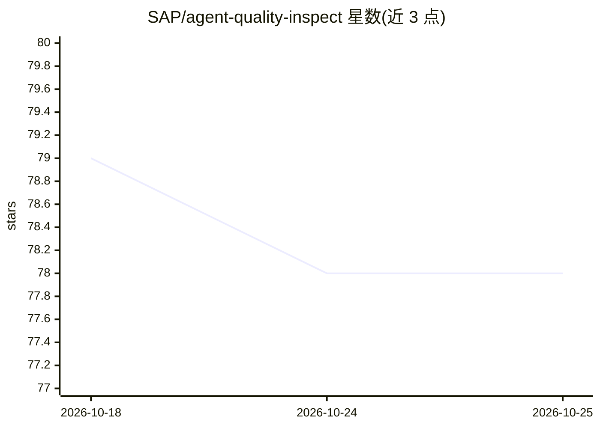

# SAP/agent-quality-inspect

⭐ 78 · Python · Apache-2.0 · 推送 2026-06-26 · [GitHub](https://github.com/SAP/agent-quality-inspect) · [官网](https://sap.github.io/agent-quality-inspect/) · 组织维护

**面向用户画像的 agent 评测与自动错误分析工具包**

SAP 开源的 TED（Talk, Evaluate, Diagnose）实现：以自然语言子目标为基准，将 agent 交互轨迹（对话、工具调用）与子目标比对，用 LLM-as-a-judge 逐轮判定进展，产出 AUC、PPT、pass@k 等指标及失败模式自动归类。内置模拟专家/非专家用户画像的 user proxy，集成 Tau2Bench 与 Toolsandbox 运行器，支持通过适配器接入自有 agent。评测指标与 user proxy 依赖 Azure OpenAI API，需 Python 3.10+。可经 pip 安装为指标库，或用 runner 复现论文实验，附 HuggingFace 预计算结果与本地排行榜 UI。

## 筛选速览

| 维度 | 判定 | 备注 |
|---|---|---|
| AI 角色 | `ai-ecosystem` | LLM/agent 周边工具 |
| 许可风险 | `permissive` | Apache-2.0 |
| 部署形态 | `library` | 以包/库形式分发 |
| 模型依赖 | locked-api |  |
| 硬件要求 | — | 无带数字的原话,不猜 |
| 安装摩擦 | `low` | 无编译、无系统依赖或容器化 |
| 成熟度 | — | 结构信号不足 |

## 能力要点

- 子目标级评测：LLM-as-a-judge 逐轮判定 agent 轨迹是否满足自然语言子目标
- 指标覆盖 AUC、PPT、pass@k、pass^k 与任务成功可靠性
- 专家/非专家用户画像的 user proxy 模拟
- 失败模式自动归类与 agent 排行榜可视化；支持 BaseAdapter/BaseSession 接入自有 agent

## 适用场景

- 评测多轮 agent 在不同用户专长水平下的表现
- 自动定位 agent 失败的具体环节与原因
- 复现论文实验或下载预计算结果查看排行榜
- 将自有 agent 轨迹接入统一指标进行对比

## 场景标签

`模型评测` · 领域:评测与运维

## 证据(README 行号)

> L23: The agent-quality-inspect toolkit evaluates agentic systems under different user personas (expert and non-expert), 
> L29: - Uses an LLM-as-a-judge to decide, for each turn, whether the behavior observed in the trace satisfies the relevan

## 星数曲线

2026-10-18 79 → 2026-10-25 78（-1）

---
*卡片 v1 · prompt 1.4 · 生成 2026-10-24 · 置信度 high · 依据 README sha `eafc8334d209` · [字段定义](../../DATASET.md)*
