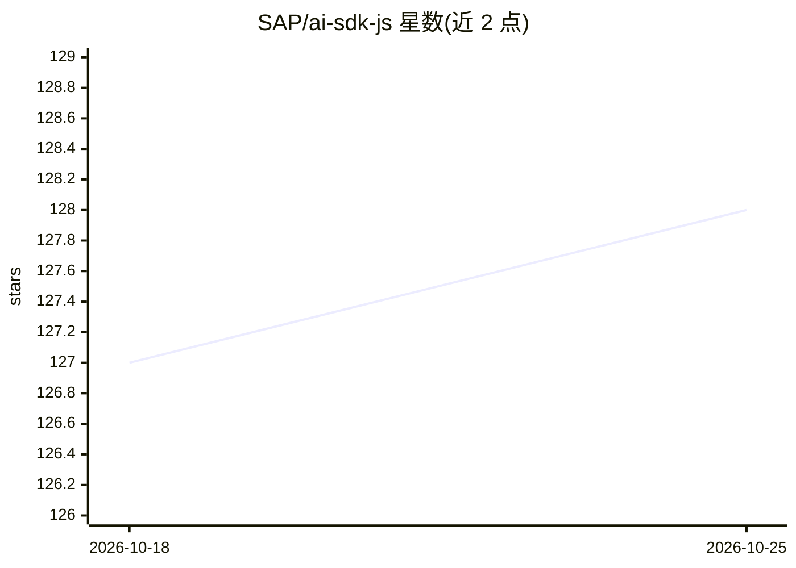

# SAP/ai-sdk-js

⭐ 128 · TypeScript · Apache-2.0 · 推送 2026-10-25 · [GitHub](https://github.com/SAP/ai-sdk-js) · 组织维护

**SAP 官方 AI SDK：接入 SAP AI Core 与生成式 AI Hub 的 JS/TS 工具包**

SAP 官方维护的 JavaScript/TypeScript SDK，面向在业务应用中集成 SAP AI Core、Generative AI Hub 与 Orchestration Service 的开发者。以 pnpm 管理的多个 npm 包形式发布：ai-api 管理场景与工作流（训练管道、批量推理、端点部署、注册 Docker/git/对象存储）、foundation-models 接入基础模型、langchain 提供 LangChain 模型客户端、orchestration 提供编排能力、document-grounding 提供文档接地 API、prompt-registry 提供提示词注册。附带示例工程，需自备 SAP AI Core 实例。

## 筛选速览

| 维度 | 判定 | 备注 |
|---|---|---|
| AI 角色 | `ai-ecosystem` | LLM/agent 周边工具 |
| 许可风险 | `permissive` | Apache-2.0 |
| 部署形态 | `library` | 以包/库形式分发 |
| 模型依赖 | — | README 未给出锁定关系 |
| 硬件要求 | — | 无带数字的原话,不猜 |
| 安装摩擦 | `low` | 无编译、无系统依赖或容器化 |
| 成熟度 | — | 结构信号不足 |

## 能力要点

- 多包发布：ai-api/foundation-models/langchain/orchestration/document-grounding/prompt-registry
- ai-api 支持训练管道、批量推理、端点部署与自定义 Docker/git/对象存储注册
- 基于基础模型客户端构建的 LangChain 模型客户端
- 提供演示各客户端用法的 TypeScript/JavaScript 示例工程

## 适用场景

- 在业务应用中集成 SAP 生成式 AI 的对话补全
- 管理 SAP AI Core 的训练与推理工作流
- 通过 LangChain 客户端在 SAP 环境中使用基础模型

## 场景标签

`提示工程` `MLOps` · 领域:Agent 开发

## 证据(README 行号)

> L7: SAP Cloud SDK for AI is the official Software Development Kit (SDK) for **SAP AI Core**, **SAP Generative AI Hub**, 
> L9: Integrate chat completion into your business applications with SAP Cloud SDK for AI.
> L21: This project publishes multiple packages and is managed using pnpm

## 星数曲线

2026-10-18 127 → 2026-10-25 128（+1）

---
*卡片 v1 · prompt 1.4 · 生成 2026-10-23 · 置信度 high · 依据 README sha `226ad58f96f4` · [字段定义](../../DATASET.md)*
