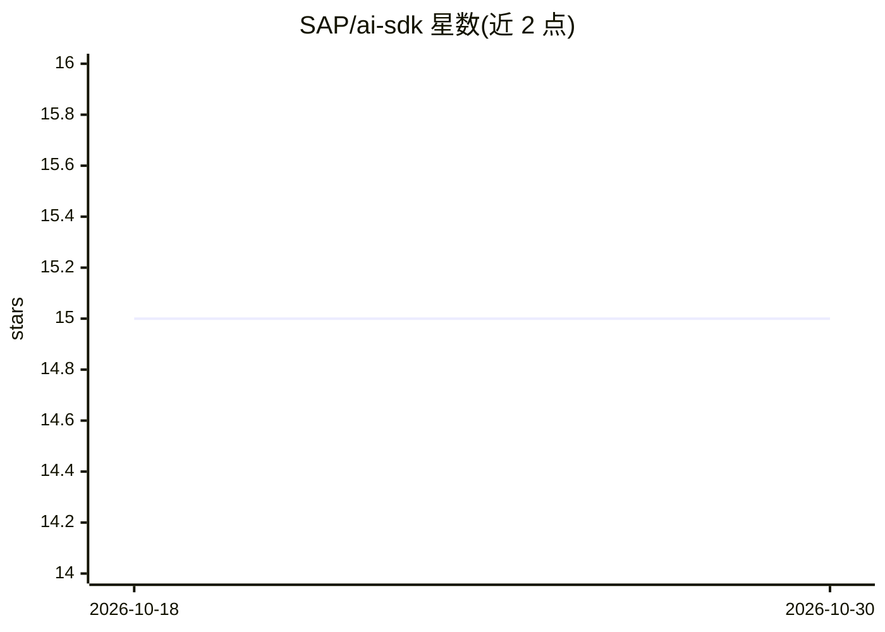

# SAP/ai-sdk

⭐ 15 · HTML · Apache-2.0 · 推送 2026-10-29 · [GitHub](https://github.com/SAP/ai-sdk) · 组织维护

**SAP Cloud SDK for AI 文档门户的源码仓库**

该仓库承载 SAP Cloud SDK for AI 官方文档站点的源码与内容：markdown 文章存放于 docs 目录，通过贡献指南与 Pull Request 流程维护。README 同时列出 SDK 各语言仓库入口（JavaScript/TypeScript、Java、Python）及支持渠道。本地构建文档站需 Node.js（推荐最新 LTS，可用 nvm 管理），通过 npm install 与 npm start 启动并在浏览器打开门户。仓库遵循 SAP 版权与 REUSE 许可规范。

## 筛选速览

| 维度 | 判定 | 备注 |
|---|---|---|
| AI 角色 | `ai-knowledge` | 知识聚合/清单类 |
| 许可风险 | `permissive` | Apache-2.0 |
| 部署形态 | `library` | 以包/库形式分发 |
| 模型依赖 | — | README 未给出锁定关系 |
| 硬件要求 | — | 无带数字的原话,不猜 |
| 安装摩擦 | `low` | 无编译、无系统依赖或容器化 |
| 成熟度 | — | 结构信号不足 |

## 能力要点

- SAP Cloud SDK for AI 官方文档门户源码
- 文档以 markdown 形式存放于 docs 目录并通过 PR 维护
- 提供 JavaScript/TypeScript、Java、Python 三种语言 SDK 的仓库入口

## 适用场景

- 查阅 SAP Cloud SDK for AI 的官方文档
- 为 SDK 文档提交修改或补充文章
- 本地构建并预览文档门户

## 场景标签

 · 领域:开发者文档/知识门户

## 证据(README 行号)

> L6: This repository contains sources for the SAP Cloud SDK for AI Documentation.
> L28: The markdown files for the documentation are in the `docs` directory.

## 星数曲线

2026-10-18 15 → 2026-10-30 15（+0）

---
*卡片 v1 · prompt 1.4 · 生成 2026-10-30 · 置信度 high · 依据 README sha `6f10df6385d9` · [字段定义](../../DATASET.md)*
