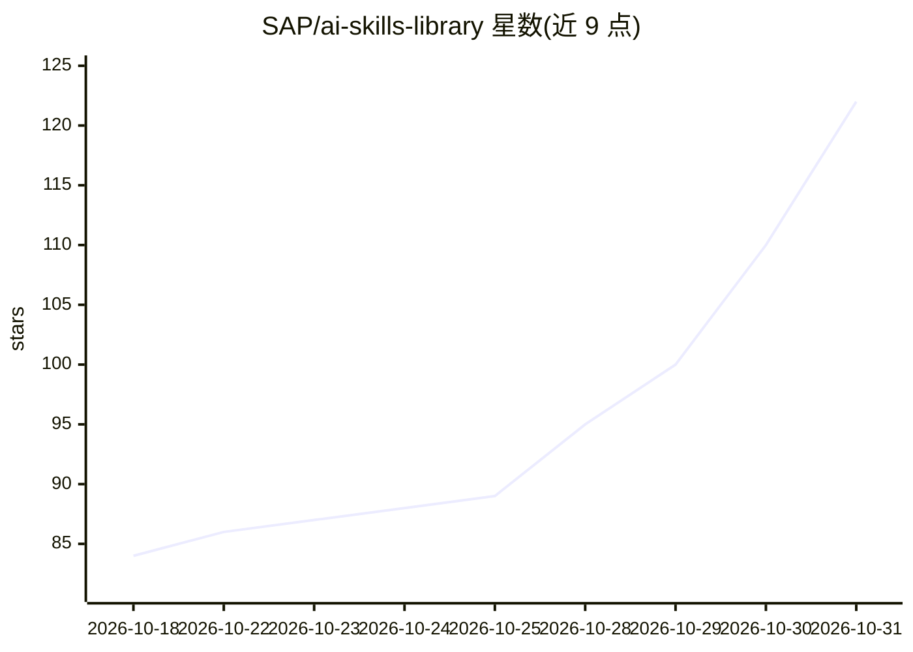

# SAP/ai-skills-library

⭐ 122 · Python · Apache-2.0 · 推送 2026-10-22 · [GitHub](https://github.com/SAP/ai-skills-library) · 组织维护

**SAP 数字助手的 AI 技能发现与安装库**

SAP 维护的 AI 技能聚合库：通过 skills CLI 搜索、筛选并安装面向 SAP 数字助手（如 Joule）的技能，支持 Claude Code、Codex、Cursor、OpenCode 等多种 agent。采用 bring-your-own-repo 模式：技能代码保存在贡献者自己的公开 GitHub 仓库，本库仅通过注册 issue 完成收录上架。提供整库安装、单技能安装、列表查看与插件安装命令，条目目录发布在 skills.cloud.sap。

## 筛选速览

| 维度 | 判定 | 备注 |
|---|---|---|
| AI 角色 | `ai-knowledge` | 知识聚合/清单类 |
| 许可风险 | `permissive` | Apache-2.0 |
| 部署形态 | `library` | 以包/库形式分发 |
| 模型依赖 | — | README 未给出锁定关系 |
| 硬件要求 | — | 无带数字的原话,不猜 |
| 安装摩擦 | `low` | 无编译、无系统依赖或容器化 |
| 成熟度 | — | 结构信号不足 |

## 能力要点

- npx skills add 一条命令安装全部或指定技能
- bring-your-own-repo 模式：技能代码保留在贡献者自己的仓库
- 支持插件安装（如 aicore-skills）
- 技能以 SKILL.md（含 name/description frontmatter）为标准格式

## 适用场景

- 为我的数字助手/agent 安装 SAP 生态的 AI 技能
- 浏览可用的 SAP AI 技能清单
- 把自己的技能仓库注册进 SAP 官方技能库

## 场景标签

`精选清单` · 领域:学习与行业

## 证据(README 行号)

> L7: Discover AI skills for SAP — search, filter, and install skills for your digital assistant.
> L11: Install skills using the skills CLI, which supports Claude Code, Codex, Cursor, OpenCode, and many more agents.

## 星数曲线

2026-10-18 84 → 2026-10-31 122（+38）

---
*卡片 v1 · prompt 1.4 · 生成 2026-10-23 · 置信度 high · 依据 README sha `d141d1d9d24f` · [字段定义](../../DATASET.md)*
