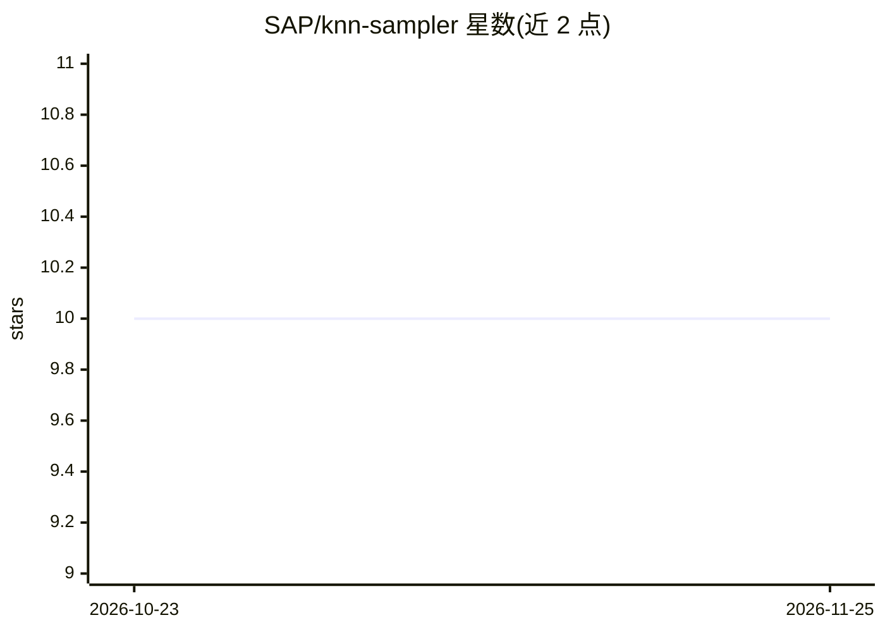

# SAP/knn-sampler

⭐ 10 · Jupyter Notebook · Apache-2.0 · 推送 2026-11-23 · [GitHub](https://github.com/SAP/knn-sampler) · 组织维护

**基于 kNN 的缺失值填补工具：恢复缺失值分布并提供不确定性量化**

SAP SE 与 Eurecom 合作的 Python 项目，实现 kNNSampler 填补算法：基于 kNN 的随机填补方法，支持多重填补（multiple imputation）与不确定性量化，目标是保留底层数据分布。附论文实验复现管线、K 折选 k 逻辑（含带惩罚的快速 leave-one-out 计算）、随机种子控制机制，以及基准测试脚本。依赖 Python 3.12+ 与 Poetry，通过 config 文件配置数据集与超参数。

## 筛选速览

| 维度 | 判定 | 备注 |
|---|---|---|
| AI 角色 | `ai-native` | 本体是模型或模型工具 |
| 许可风险 | `permissive` | Apache-2.0 |
| 部署形态 | `None` |  |
| 模型依赖 | — | README 未给出锁定关系 |
| 硬件要求 | — | 无带数字的原话,不猜 |
| 安装摩擦 | `low` | 无编译、无系统依赖或容器化 |
| 成熟度 | — | 结构信号不足 |

## 能力要点

- kNN 随机填补，支持多重填补与不确定性量化
- K 折选 k 使用带 (k+1)^2/k^2 惩罚的快速 leave-one-out 计算
- 种子化的可复现运行（数据准备与执行两级种子）
- 内置基准测试脚本对比多种填补算法

## 适用场景

- 填补数据集中缺失值并量化填补不确定性
- 复现 kNNSampler 论文中的实验结果
- 对多种填补算法做基准对比测试

## 场景标签

 · 领域:机器学习/数据预处理

## 证据(README 行号)

> L5: This project is a Python application for missing-value imputation and for reproducing the experiments from the publi
> L10: **knnSampler** is a kNN-based method for missing-value imputation with support for multiple imputation and uncertai

## 星数曲线

2026-10-23 10 → 2026-11-25 10（+0）

---
*卡片 v1 · prompt 1.4 · 生成 2026-11-20 · 置信度 high · 依据 README sha `01f08b1ec1bc` · [字段定义](../../DATASET.md)*
