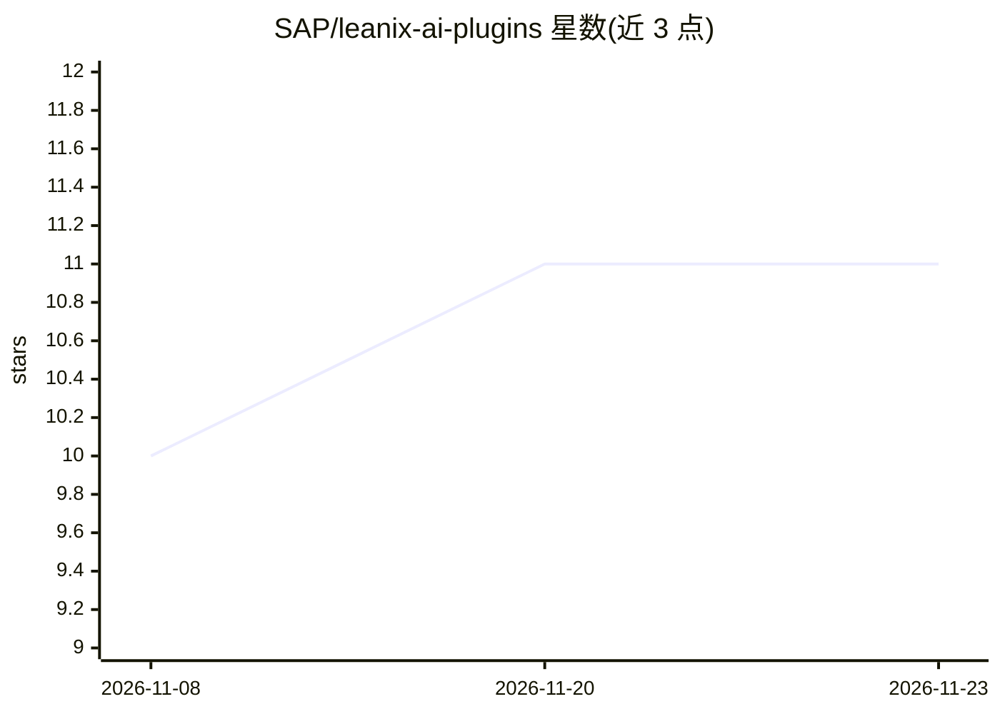

# SAP/leanix-ai-plugins

⭐ 11 · JavaScript · Apache-2.0 · 推送 2026-11-10 · [GitHub](https://github.com/SAP/leanix-ai-plugins) · 组织维护

**为 AI 编码代理提供 LeanIX 技能与 MCP 集成的插件集**

SAP LeanIX 官方发布的 Agent Skills 集合：以 sap-leanix 插件打包自动化脚本、计算、图表、Fact Sheet 检索等技能，供 Claude Code、Cursor、GitHub Copilot、OpenAI Codex、Gemini CLI 等多种 AI 工具加载，配合 LeanIX MCP Server 通过自然语言操作 LeanIX。仓库本身是 Claude Code 插件市场，一条命令安装全部技能；首次使用时经 OAuth 连接 MCP Server，其他代理或 API token 认证需参考 MCP-SETUP.md。

## 筛选速览

| 维度 | 判定 | 备注 |
|---|---|---|
| AI 角色 | `ai-ecosystem` | LLM/agent 周边工具 |
| 许可风险 | `permissive` | Apache-2.0 |
| 部署形态 | `None` |  |
| 模型依赖 | — | README 未给出锁定关系 |
| 硬件要求 | — | 无带数字的原话,不猜 |
| 安装摩擦 | `low` | 无编译、无系统依赖或容器化 |
| 成熟度 | — | 结构信号不足 |

## 能力要点

- 单一 sap-leanix 插件打包全部技能，追加 skills 数组即可扩展
- 遵循 Agent Skills 开放标准，支持多种主流 AI 编码工具
- 内置 LeanIX MCP Server 配置，Claude Code 首次使用自动触发 OAuth

## 适用场景

- 在 Claude Code 中用自然语言检索和统计 LeanIX Fact Sheet
- 让 AI 代理创建和编辑 LeanIX 架构图
- 通过对话构建和调试 LeanIX 自动化脚本与计算

## 场景标签

`Agent 框架` · 领域:Agent 开发

## 证据(README 行号)

> L7: A collection of Agent Skills for SAP LeanIX — reusable, portable instructions that extend AI coding agents with Lean
> L9: The skills in this repository are designed to work with the LeanIX MCP Server, which exposes LeanIX capabilities as 

## 星数曲线

2026-11-08 10 → 2026-11-23 11（+1）

---
*卡片 v1 · prompt 1.4 · 生成 2026-11-20 · 置信度 high · 依据 README sha `b587bc35db5b` · [字段定义](../../DATASET.md)*
