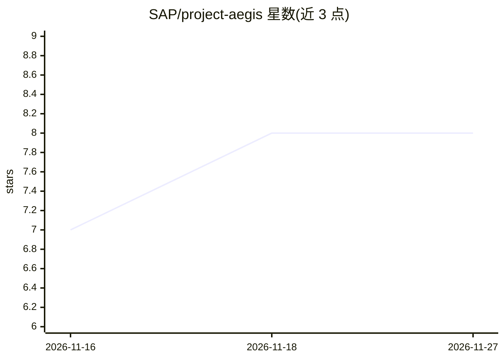

# SAP/project-aegis

⭐ 8 · Python · Apache-2.0 · 推送 2026-11-26 · [GitHub](https://github.com/SAP/project-aegis) · 组织维护

**为 AI 工作流提供可组合 guardrail 的 Python 库**

SAP 开源的 Python guardrail 库：在 agent 输入输出两侧校验与清洗内容。核心是 Guard（并发检测）与 MutationGuard（顺序检测并修复）两类原语，通过 .use() 链式组装验证器，on_fail 支持 LOG/EXCEPTION/NOOP 及自定义回调。内置 XSS、XXE、SQL 注入、prompt 泄漏、敏感词等检测器与基于 nh3 的 HTML 清洗器；支持同形字/NFKC 归一化对抗混淆绕过；提供 a2a-sdk 集成（装饰器与 Executor 包装）。需 Python ≥3.13，首次发布前需从仓库安装。

## 筛选速览

| 维度 | 判定 | 备注 |
|---|---|---|
| AI 角色 | `ai-ecosystem` | LLM/agent 周边工具 |
| 许可风险 | `permissive` | Apache-2.0 |
| 部署形态 | `library` | 以包/库形式分发 |
| 模型依赖 | — | README 未给出锁定关系 |
| 硬件要求 | — | 无带数字的原话,不猜 |
| 安装摩擦 | `low` | 无编译、无系统依赖或容器化 |
| 成熟度 | — | 结构信号不足 |

## 能力要点

- Guard 并发检测 / MutationGuard 顺序检测并修复的双原语设计
- 归一化对抗同形字、全角、零宽字符等混淆绕过，检测前折叠、原文转发
- 内置 XSS/XXE/SQL 注入/Prompt 泄漏等检测器，支持自定义验证器
- OpenTelemetry span 默认埋点，a2a-sdk 集成零改动包裹既有 agent

## 适用场景

- 拦截 agent 输入中的注入攻击与屏蔽词
- 清洗模型输出中的 HTML 与系统提示泄漏
- 为 A2A agent 统一添加输入输出安全检查

## 场景标签

`网络安全` · 领域:学习与行业

## 证据(README 行号)

> L13: places a composable guardrail in front of and behind your agent, so your agent
> L41:  Python: fast, offline, reproducible, free to run.

## 星数曲线

2026-11-16 7 → 2026-11-27 8（+1）

---
*卡片 v1 · prompt 1.4 · 生成 2026-11-20 · 置信度 high · 依据 README sha `b8f8c3514d2c` · [字段定义](../../DATASET.md)*
