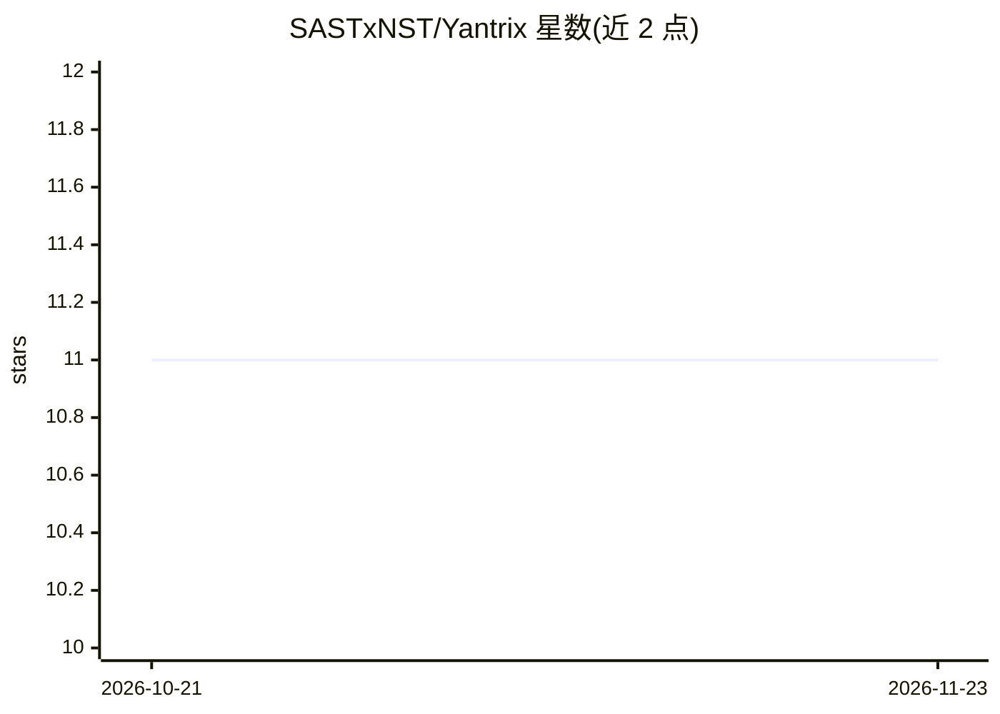

# SASTxNST/Yantrix

⭐ 11 · TypeScript · MIT · 推送 2026-04-25 · [GitHub](https://github.com/SASTxNST/Yantrix) · 组织维护

**面向航天领域的协作平台：数据集、AI/ML 实验与卫星挑战赛**

Yantrix 是一个 space-tech 协作平台，定位为空间数据集、卫星挑战赛、AI/ML 实验、科研协作与工程创新的载体。本仓库提供其全栈开发环境：React+Vite+TypeScript 前端、Node.js+Express 后端、PostgreSQL+Prisma 数据库，并通过 Docker Compose 编排。README 主体内容为贡献者上手流程：git clone 后用 npm install 安装依赖，npx orbit start 一键构建容器、启动前后端与数据库、执行迁移并进入 Orbit 交互式 shell，orbit> 中可执行 stop_orbit/logs 等命令；Orbit CLI 用于封装常用的 docker compose 与 prisma migrate 命令。

## 筛选速览

| 维度 | 判定 | 备注 |
|---|---|---|
| AI 角色 | `ai-ecosystem` | LLM/agent 周边工具 |
| 许可风险 | `permissive` | MIT |
| 部署形态 | `self-host` | docker 或自建部署 |
| 模型依赖 | — | README 未给出锁定关系 |
| 硬件要求 | — | 无带数字的原话,不猜 |
| 安装摩擦 | `low` | 无编译、无系统依赖或容器化 |
| 成熟度 | — | 结构信号不足 |

## 能力要点

- Orbit CLI 封装 docker compose 与 prisma migrate，提供 start/stop/restart/logs/migrate 命令
- npx orbit start 一键构建并启动前端、后端与 PostgreSQL，自动应用迁移
- 交互式 orbit> shell，支持容器级日志查看与选择性退出
- MIT 许可

## 适用场景

- 作为贡献者搭建并运行 Yantrix 开发环境
- 参与空间数据集与卫星挑战赛协作
- 在平台上进行 AI/ML 实验与科研协作

## 场景标签

 · 领域:航天/科研协作平台

## 证据(README 行号)

> L3: Yantrix is a next-generation space-tech collaboration platform — built specifically for **space datasets, satellite 
> L10: - **DevOps** → Docker + Docker Compose

## 星数曲线

2026-10-21 11 → 2026-11-23 11（+0）

---
*卡片 v1 · prompt 1.4 · 生成 2026-11-19 · 置信度 mid · 依据 README sha `ae42f5f34fed` · [字段定义](../../DATASET.md)*
