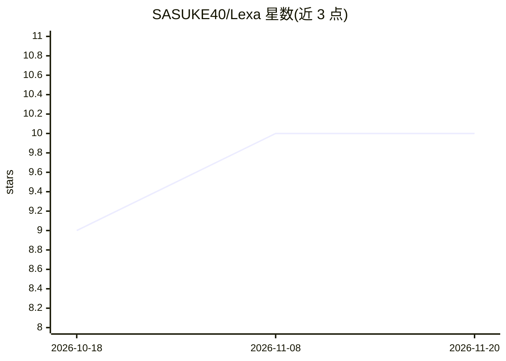

# SASUKE40/Lexa

⭐ 10 · Swift · MIT · 推送 2026-10-09 · [GitHub](https://github.com/SASUKE40/Lexa) · [官网](https://edward40.com/Lexa/) · 个人维护

**macOS 菜单栏文本润色工具：快捷键调用 LLM 校对/改写/翻译选中文本**

macOS 菜单栏应用，仿 Grammarly 的工作方式：在任意应用中选中文本后按 ⌥⌘G 弹窗处理，支持语法拼写纠正、改写为 ASD-STE100 简明技术英语、四种语气调整及 15 种语言翻译。模型接入方式覆盖 OpenRouter/Nous Portal/GitHub Models 登录、多家免费 API key、Ollama/LM Studio 本地模型，以及通过 codex/claude CLI 复用 ChatGPT 或 Claude 订阅；密钥存于 macOS Keychain。需要 macOS 26+，需授予辅助功能权限，安装包未经 Apple 公证需手动放行。

## 筛选速览

| 维度 | 判定 | 备注 |
|---|---|---|
| AI 角色 | `ai-native` | 本体是模型或模型工具 |
| 许可风险 | `permissive` | MIT |
| 部署形态 | `desktop` | 安装包/桌面程序 |
| 模型依赖 | local-ok | 支持本地模型 |
| 硬件要求 | — | 无带数字的原话,不猜 |
| 安装摩擦 | `low` | 无编译、无系统依赖或容器化 |
| 成熟度 | — | 结构信号不足 |

## 能力要点

- ⌥⌘G 全局快捷键处理选中文本，回车即替换
- 支持本地模型（Ollama/LM Studio），文本不出本机
- 可经 codex/claude CLI 使用 ChatGPT/Claude 订阅
- 自定义 OpenAI 兼容 /chat/completions 端点

## 适用场景

- 写邮件或文档时快捷修正语法与拼写
- 把技术文档改写成简明技术英语
- 在本地模型下离线润色敏感文本
- 快捷将选中文本翻译成其他语言

## 场景标签

`AI 写作` · 领域:内容生成

## 证据(README 行号)

> L5:  A small Grammarly alternative for macOS.
> L35: 2. Press **⌥⌘G**.
> L49: ## Providers

## 星数曲线

2026-10-18 9 → 2026-11-20 10（+1）

---
*卡片 v1 · prompt 1.4 · 生成 2026-11-20 · 置信度 high · 依据 README sha `f5c2b6973f37` · [字段定义](../../DATASET.md)*
