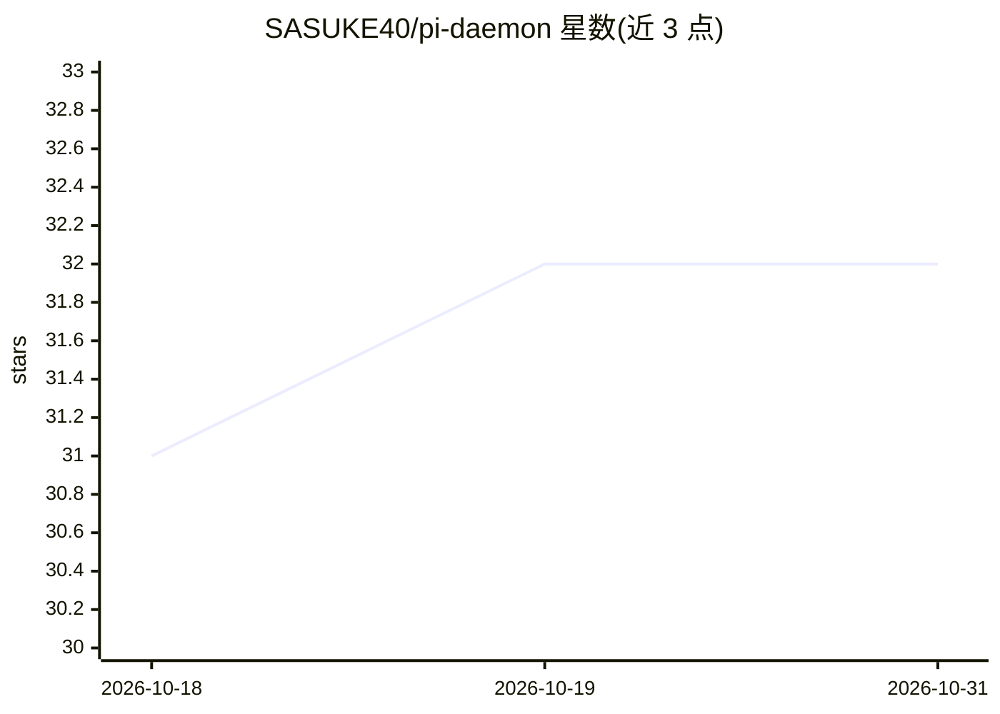

# SASUKE40/pi-daemon

⭐ 32 · TypeScript · MIT · 推送 2026-08-16 · [GitHub](https://github.com/SASUKE40/pi-daemon) · 个人维护

**把 Pi 编程 agent 跑成持久会话并通过移动 PWA 安全远程使用**

在服务器上以持久会话运行 Pi 编程 agent，通过仅监听 loopback 的 Web 网关提供移动端 PWA 界面，支持多会话并行与会话恢复。接入方式二选一：私有的 Tailscale Serve，或经 Cloudflare Tunnel 暴露公网域名并以精确邮箱 + One-time PIN 的 Access 策略保护。提供一行安装脚本（自带 Node.js 24.19.0 LTS 运行时）与 Docker 镜像两种安装途径；支持通过 models.json 接入 Ollama、LM Studio、vLLM 等自定义模型提供方。认证后的用户可执行命令与修改文件，README 明确提示需限定访问身份。

## 筛选速览

| 维度 | 判定 | 备注 |
|---|---|---|
| AI 角色 | `ai-ecosystem` | LLM/agent 周边工具 |
| 许可风险 | `permissive` | MIT |
| 部署形态 | `self-host` | docker 或自建部署 |
| 模型依赖 | local-ok | 支持本地模型 |
| 硬件要求 | — | 无带数字的原话,不猜 |
| 安装摩擦 | `low` | 无编译、无系统依赖或容器化 |
| 成熟度 | — | 结构信号不足 |

## 能力要点

- Pi 会话持久化：关闭浏览器或重启网关不终止运行，会话可恢复
- Cloudflare Tunnel + 精确邮箱 Access 策略（One-time PIN）或 Tailscale Serve 两种远程接入
- 一行安装脚本自带 Node.js 运行时，无需 root；另有 Docker 镜像（amd64/arm64）
- 通过 models.json 接入 Ollama / LM Studio / vLLM / OpenAI 兼容代理等自定义模型

## 适用场景

- 在服务器上长时间运行编程 agent，用手机随时接续会话
- 不开入站端口、通过公网域名安全地远程使用编程 agent
- 用本地模型（Ollama/vLLM）替代云端 API 驱动编程 agent

## 场景标签

`编码 Agent` · 领域:编码与开发

## 证据(README 行号)

> L3: Pi Daemon runs the Pi coding agent in a persistent server session, serves a focused mobile PWA on loopback, and make

## 星数曲线

2026-10-18 31 → 2026-10-31 32（+1）

---
*卡片 v1 · prompt 1.4 · 生成 2026-10-26 · 置信度 mid · 依据 README sha `e4492394548f` · [字段定义](../../DATASET.md)*
