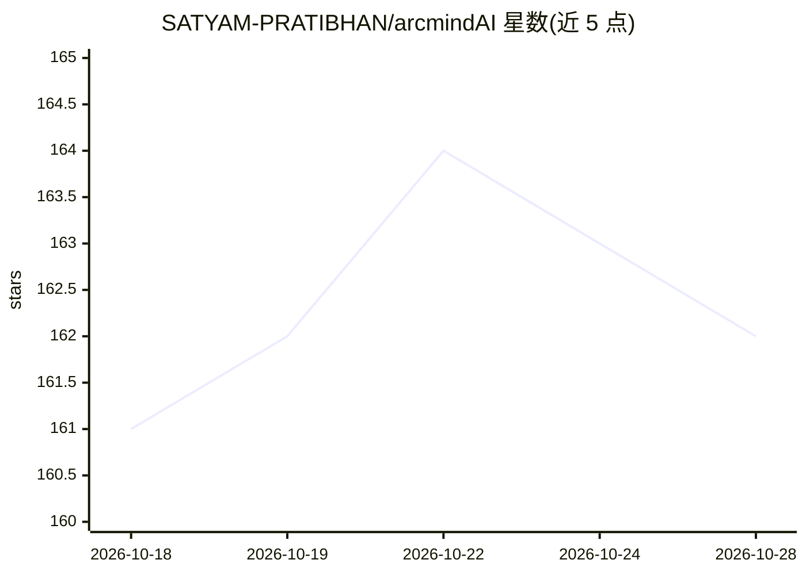

# SATYAM-PRATIBHAN/arcmindAI

⭐ 162 · TypeScript · MIT · 推送 2026-10-26 · [GitHub](https://github.com/SATYAM-PRATIBHAN/arcmindAI) · [官网](https://arcmind-ai.netlify.app) · 个人维护

**用自然语言生成系统架构设计的 AI Web 应用**

基于 Next.js 的 Web 应用：用户用自然语言描述需求，由 Google Gemini 与 LangChain 生成包含架构图（Mermaid）、组件与技术栈推荐的系统设计；也可导入 GitHub 仓库自动分析并生成架构图。支持将设计拆解为开发任务（分类、优先级、工时估算、依赖跟踪并缓存）。含账号认证（OTP）、生成历史、速率限制（每用户 2 分钟 1 次）、Prometheus 监控；GitHub 令牌以 AES-256-GCM 加密存储。需配置 MongoDB、Gemini API key 等环境变量，提供 Docker Compose 全栈运行。

## 筛选速览

| 维度 | 判定 | 备注 |
|---|---|---|
| AI 角色 | `ai-native` | 本体是模型或模型工具 |
| 许可风险 | `permissive` | MIT |
| 部署形态 | `self-host` | docker 或自建部署 |
| 模型依赖 | — | README 未给出锁定关系 |
| 硬件要求 | — | 无带数字的原话,不猜 |
| 安装摩擦 | `low` | 无编译、无系统依赖或容器化 |
| 成熟度 | — | 结构信号不足 |

## 能力要点

- 自然语言生成架构图、组件与技术栈推荐（Gemini + LangChain）
- 导入 GitHub 仓库自动分析并生成 Mermaid 架构图
- AI 任务拆解：分类、优先级、工时估算、依赖跟踪并缓存
- Docker Compose 一键运行 MongoDB/Redis/应用全栈

## 适用场景

- 把产品想法快速转成可编辑的架构图与技术栈方案
- 分析现有 GitHub 仓库并生成架构图
- 将系统设计拆解为带优先级和工时估算的开发任务清单

## 场景标签

 · 领域:软件开发/系统设计

## 证据(README 行号)

> L3: Generate structured system designs using AI. Describe your requirements and get detailed architecture diagrams, comp
> L9: - **AI-Powered Generation**: Leverage Google Gemini and LangChain to create comprehensive system designs from natura
> L178: - Describe your system requirements in natural language

## 星数曲线

2026-10-18 161 → 2026-10-28 162（+1）

---
*卡片 v1 · prompt 1.4 · 生成 2026-10-22 · 置信度 mid · 依据 README sha `90a234c84f4a` · [字段定义](../../DATASET.md)*
