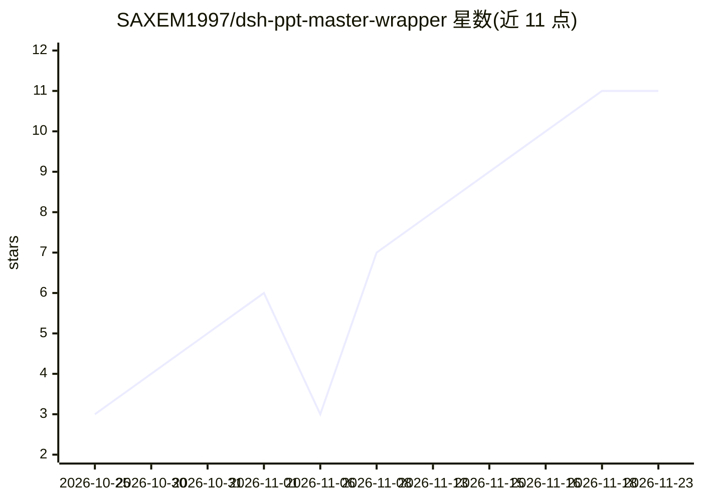

# SAXEM1997/dsh-ppt-master-wrapper

⭐ 11 · JavaScript · MIT · 推送 2026-11-19 · [GitHub](https://github.com/SAXEM1997/dsh-ppt-master-wrapper) · 个人维护 · 中文 README

**把 ppt-master 技能集封装为 DeepSeek Harness 插件，供 agent 生成 PPTX**

将上游 ppt-master AI 演示文稿技能集逐字节 vendor 为 DeepSeek Harness (DSH) 插件：不改写上游内容，通过 index.js 注册技能面，暴露 info/check_env/setup_deps 三个生命周期工具，提供可选 venv 解释器隔离、插件页图形化配置卡片（中英双语）与工具可见范围控制，附带 sync-upstream.mjs 脚本一键同步上游新版本并经完整性门校验。安装需要 DSH ≥ 0.2.0-rc.2、Node.js ≥ 22.12 与 python3 ≥ 3.10，上游技能的 Python 依赖按需安装。

## 筛选速览

| 维度 | 判定 | 备注 |
|---|---|---|
| AI 角色 | `ai-ecosystem` | LLM/agent 周边工具 |
| 许可风险 | `permissive` | MIT |
| 部署形态 | `library` | 以包/库形式分发 |
| 模型依赖 | — | README 未给出锁定关系 |
| 硬件要求 | — | 无带数字的原话,不猜 |
| 安装摩擦 | `low` | 无编译、无系统依赖或容器化 |
| 成熟度 | — | 结构信号不足 |

## 能力要点

- vendor 的 skills/ppt-master/ 与上游 release 逐字节一致，经 attribution_guard.py 完整性门校验
- 三个 venv 感知的生命周期工具，setup_deps 幂等安装 Python 依赖
- 可选 venv 解释器隔离与容器持久卷配置建议
- 插件页配置卡片保存免重启生效，支持工具可见范围按工作区收窄

## 适用场景

- 在 DeepSeek Harness 中为 agent 装载 ppt-master 演示文稿技能
- 容器环境下用 venv 隔离上游脚本的 Python 解释器
- 多工作区场景下把 PPT 工具限制在指定工作区可见
- 跟踪并同步上游 ppt-master 的新版本发布

## 场景标签

 · 领域:AI Agent 工具/插件生态

## 证据(README 行号)

> L7: **把上游 ppt-master 技能集忠实封装为 DeepSeek Harness (DSH) 插件** —— 逐字节 vendor、零改写、零运行时依赖、可一键同步上游。
> L9: 上游技能集本身是一个完整的 AI 演示文稿工作流（生成 / 重构 / 美化 PPTX、Brand·Style·Layout·Deck 工作区、原生模板填充）。本包装层不做任何内容改写，只负责**把它可靠地装进 DSH**：注册技能、
> L26: 技能面由 `index.js` 经 `ctx.skills` 注册：vendor 的 `ppt-master` 技能＋一个**内存合成、不落盘**的入口技能 `ppt-master-env`（解释器路由入口）。DSH 通过 `re

## 星数曲线

2026-10-25 3 → 2026-11-23 11（+8）

---
*卡片 v1 · prompt 1.4 · 生成 2026-11-18 · 置信度 mid · 依据 README sha `30b159fa8305` · [字段定义](../../DATASET.md)*
