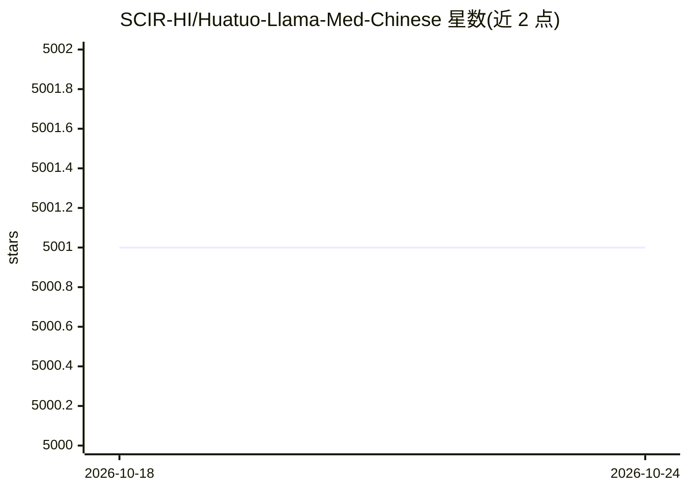

# SCIR-HI/Huatuo-Llama-Med-Chinese

⭐ 5,001 · Python · Apache-2.0 · 推送 2026-07-04 · [GitHub](https://github.com/SCIR-HI/Huatuo-Llama-Med-Chinese) · 组织维护 · 中文 README

**中文医学指令微调大模型集（本草/华驼），供医学问答研究**

哈尔滨工业大学SCIR实验室开源的中文医学指令微调模型仓库：基于医学知识图谱（主要参考cMeKG）与医学文献，结合ChatGPT API构建中文医学指令微调数据集，对LLaMA、Alpaca-Chinese、Bloom、活字等基模型进行半精度LoRA微调，输出医学问答模型。提供LoRA权重下载（百度网盘/Hugging Face）、推理与微调脚本、八千余条训练数据及肝癌文献问答样例。免责声明明确仅供学术研究、禁止商用，输出不能作为医学诊断依据。

## 筛选速览

| 维度 | 判定 | 备注 |
|---|---|---|
| AI 角色 | `ai-native` | 本体是模型或模型工具 |
| 许可风险 | `permissive` | Apache-2.0 |
| 部署形态 | `library` | 以包/库形式分发 |
| 模型依赖 | — | README 未给出锁定关系 |
| 硬件要求 | `gpu-24g` | |
| 安装摩擦 | `low` | 无编译、无系统依赖或容器化 |
| 成熟度 | — | 结构信号不足 |

## 能力要点

- 对LLaMA/Alpaca/Bloom/活字四类基模型的LoRA指令微调权重
- 基于cMeKG医学知识库与GPT3.5构建的中文医学指令数据集（八千余条）
- 知识微调三阶段方法（问题→知识→回答），相关论文被ACM TKDD录用
- 提供推理与自定义数据微调脚本

## 适用场景

- 下载权重运行中文医学问答推理测试
- 用自定义医学数据对基模型做LoRA指令微调
- 获取中文医学指令微调数据集用于研究

## 场景标签

`微调` `科研工具` · 领域:学习与行业

## 证据(README 行号)

> L11: 本项目开源了经过中文医学指令精调/指令微调(Instruction-tuning) 的大语言模型集，包括LLaMA、Alpaca-Chinese、Bloom、活字模型等。
> L13: 我们基于医学知识图谱以及医学文献，结合ChatGPT API构建了中文医学指令微调数据集，并以此对各种基模型进行了指令微调，提高了基模型在医疗领域的问答效果。

## 星数曲线

2026-10-18 5,001 → 2026-10-24 5,001（+0）

---
*卡片 v1 · prompt 1.4 · 生成 2026-10-20 · 置信度 mid · 依据 README sha `f2ed1897617e` · [字段定义](../../DATASET.md)*
