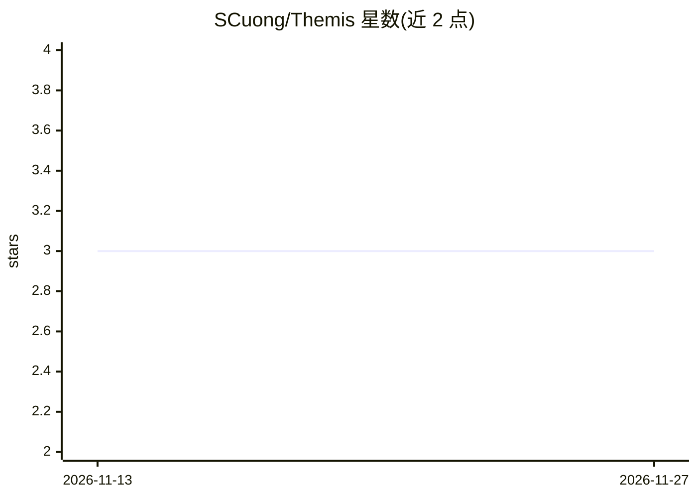

# SCuong/Themis

⭐ 3 · TypeScript · NOASSERTION · 推送 2026-11-25 · [GitHub](https://github.com/SCuong/Themis) · 个人维护

**多模型群聊协作的 Chrome 扩展：多 AI 各担角色互评答案**

一个 Manifest V3 Chrome 扩展，把 Claude、ChatGPT、Gemini、Grok、DeepSeek 网页端嵌入同一工作区组聊天室：用户为每个成员分配角色（persona），提供协作讨论、独立专家两种模式，以及节点式工作流编排（含评审步骤与执行次数上限，默认 50、最多 200）。内置 308 个角色与 45 个团队模板。无后端，数据存于浏览器本地；网站成员复用用户已登录会话，API 成员直连用户自配的 OpenAI/Anthropic 格式端点。需从源码构建后以未打包方式加载，未上架 Chrome 商店。

## 筛选速览

| 维度 | 判定 | 备注 |
|---|---|---|
| AI 角色 | `ai-native` | 本体是模型或模型工具 |
| 许可风险 | `none` | NOASSERTION |
| 部署形态 | `desktop` | 安装包/桌面程序 |
| 模型依赖 | locked-api |  |
| 硬件要求 | — | 无带数字的原话,不猜 |
| 安装摩擦 | `low` | 无编译、无系统依赖或容器化 |
| 成熟度 | — | 结构信号不足 |

## 能力要点

- 五个 AI 网站成员 + 自配 API 成员的群聊与 @Name/@all 路由
- 节点式工作流编排：并行节点、结构化评审、自动编排草稿
- 308 个开箱角色与 45 个团队模板，可自建并 AI 生成 persona
- 可复现构建（依赖锁定、SHA-256 哈希）与针对真实站点的 E2E 测试

## 适用场景

- 让多个模型从不同角色视角回答同一问题并互相批判
- 搭建带评审与回退步骤的多成员工作流
- 产品评审、合同审查、论文写作等团队模板化多模型讨论

## 场景标签

`多智能体` `工作流自动化` · 领域:Agent 开发

## 证据(README 行号)

> L3: **A Chrome extension workspace where several AI assistants work on one problem together: each takes a role, answers,
> L22: - Members can run on **Gemini, ChatGPT, Claude, DeepSeek or Grok** through their websites, or on an **external API 
> L67: Themis is a Manifest V3 Chrome extension. There is no backend.

## 星数曲线

2026-11-13 3 → 2026-11-27 3（+0）

---
*卡片 v1 · prompt 1.4 · 生成 2026-11-22 · 置信度 high · 依据 README sha `86b199fa7c46` · [字段定义](../../DATASET.md)*
