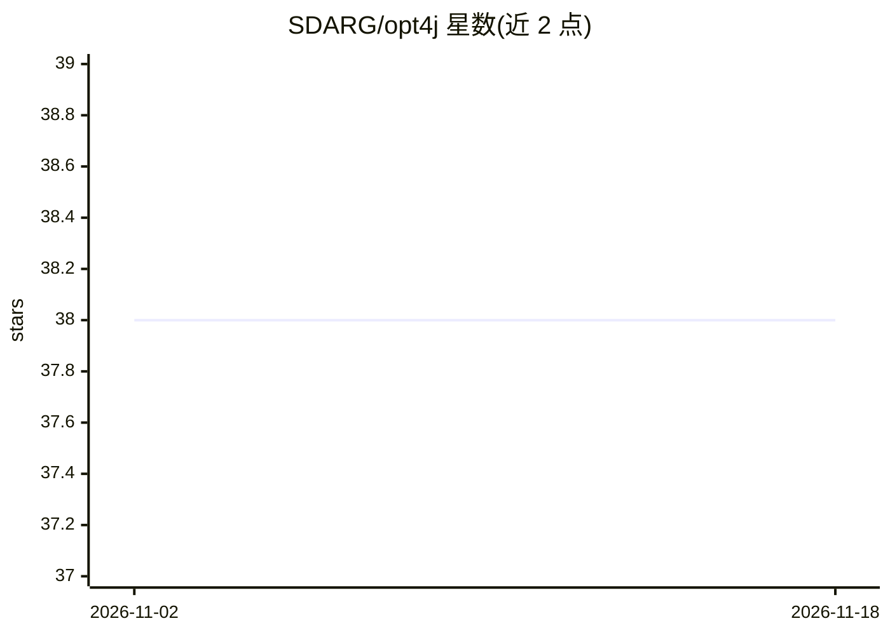

# SDARG/opt4j

⭐ 38 · Java · MIT · 推送 2026-11-02 · [GitHub](https://github.com/SDARG/opt4j) · [官网](https://sdarg.github.io/opt4j/) · 组织维护

**Java 模块化元启发式优化框架，供用户求解优化问题**

基于 Java 的开源演化计算框架，内置多种（多目标）优化算法：演化算法（含 SPEA2、NSGA2）、差分演化、粒子群优化与模拟退火，并附带 ZDT、DTLZ、WFG 与背包问题基准。目标是简化用户自定义问题的演化优化以及任意元启发式算法的实现；采用模块化结构，提供图形界面用于配置与优化过程可视化。可独立 Swing 应用或库使用，3.4 版起需 Java 21+。

## 筛选速览

| 维度 | 判定 | 备注 |
|---|---|---|
| AI 角色 | `ai-native` | 本体是模型或模型工具 |
| 许可风险 | `permissive` | MIT |
| 部署形态 | `None` |  |
| 模型依赖 | — | README 未给出锁定关系 |
| 硬件要求 | — | 无带数字的原话,不猜 |
| 安装摩擦 | `medium` | 含编译或系统依赖之一 |
| 成熟度 | — | 结构信号不足 |

## 能力要点

- 内置 SPEA2、NSGA2 等多目标演化算法及差分演化/粒子群/模拟退火
- 附带 ZDT、DTLZ、WFG 与背包问题基准
- 模块化结构，提供 GUI 配置与优化过程可视化
- 可作独立应用运行或作为库嵌入

## 适用场景

- 定义自己的优化问题并套用现成元启发式算法求解
- 实现并测试自定义的元启发式优化算法
- 用基准问题比较优化算法表现

## 场景标签

 · 领域:优化算法/演化计算

## 证据(README 行号)

> L8: Opt4J is an open source Java-based framework for evolutionary computation.
> L9: It contains a set of (multi-objective) optimization algorithms such as evolutionary algorithms (including SPEA2 and 

## 星数曲线

2026-11-02 38 → 2026-11-18 38（+0）

---
*卡片 v1 · prompt 1.4 · 生成 2026-11-18 · 置信度 high · 依据 README sha `5fd0d9db923b` · [字段定义](../../DATASET.md)*
