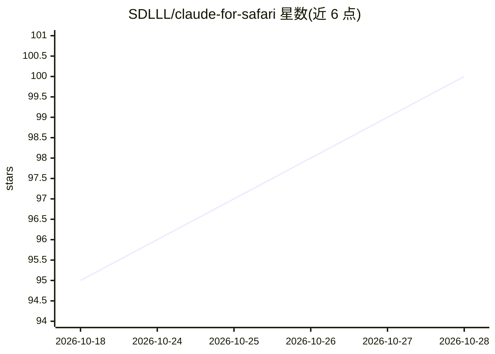

# SDLLL/claude-for-safari

⭐ 100 · JavaScript · MIT · 推送 2026-08-04 · [GitHub](https://github.com/SDLLL/claude-for-safari) · [官网](https://safari.skilljam.dev) · 个人维护 · 中文 README

**让 AI Agent 通过 AppleScript 直接控制 macOS Safari 的技能**

面向 Claude Code 类 AI Agent 的浏览器控制技能（SKILL.md 形式），通过 npx skills 一条命令安装。不依赖浏览器扩展、代理或常驻进程，核心机制为 AppleScript、页面 JavaScript、screencapture 及可选的 Swift 编译辅助工具，实现对真实 Safari 会话的标签页列举、页面读取、JS 执行、截图、点击、填表、滚动与网络请求观察等操作。要求 macOS，需在系统设置中授予终端控制 Safari 等权限；仅支持 Safari，不兼容 Chrome/Firefox/Arc。内置目标验证与敏感表单字段排除等安全约束。

## 筛选速览

| 维度 | 判定 | 备注 |
|---|---|---|
| AI 角色 | `ai-ecosystem` | LLM/agent 周边工具 |
| 许可风险 | `permissive` | MIT |
| 部署形态 | `library` | 以包/库形式分发 |
| 模型依赖 | — | README 未给出锁定关系 |
| 硬件要求 | — | 无带数字的原话,不猜 |
| 安装摩擦 | `low` | 无编译、无系统依赖或容器化 |
| 成熟度 | — | 结构信号不足 |

## 能力要点

- 无扩展/无代理/无常驻进程，直接控制真实 Safari
- 标签页管理、页面读取、JS 执行、截图、点击、填表、滚动等 14 项能力
- 两种截图模式（后台 Screen Recording / 用户可见回退）
- 安全约束：目标验证、保留站点确认弹窗、排除敏感表单字段

## 适用场景

- 让 Claude Code 等 Agent 直接操作我已登录的 Safari 会话完成网页任务
- 无需浏览器扩展即可让 AI 读取和控制 Safari 页面
- Agent 自动截图查看页面并结合页面内容执行操作

## 场景标签

`浏览器自动化` · 领域:效率与自动化

## 证据(README 行号)

> L3:  Give your AI Agent the power to control Safari
> L63: No browser extension, proxy, or persistent daemon. The core uses macOS-native capabilities; optional window helpers
> L91: Claude Code ──osascript──► Safari (reads/controls your real browser)

## 星数曲线

2026-10-18 95 → 2026-10-28 100（+5）

---
*卡片 v1 · prompt 1.4 · 生成 2026-10-23 · 置信度 high · 依据 README sha `36e08563d6fb` · [字段定义](../../DATASET.md)*
