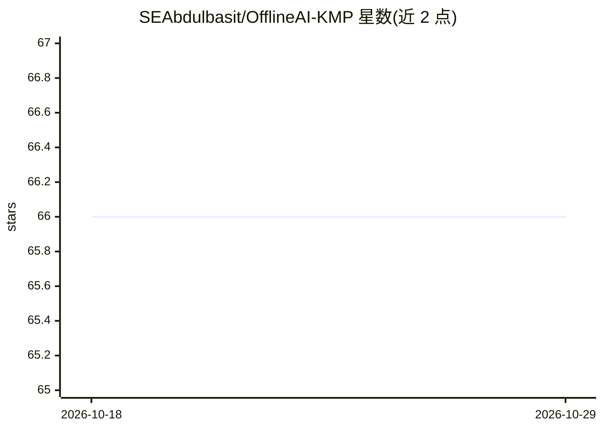

# SEAbdulbasit/OfflineAI-KMP

⭐ 66 · Kotlin · 推送 2026-07-11 · [GitHub](https://github.com/SEAbdulbasit/OfflineAI-KMP) · 个人维护

**在 Android/iOS 上离线运行 Gemma 对话的跨平台应用**

基于 Kotlin Multiplatform 与 Compose Multiplatform 的移动端聊天应用：通过 LiteRT-LM 在 Android 与 iOS 设备上本地运行 Google Gemma 模型，全程无需联网，支持逐 token 流式输出、图片与 PDF 附件、多模型导入管理与生成参数调节；iOS 端提供 Swift async/await 与 AsyncStream 接口。模型需自行从 Kaggle 或 Hugging Face 下载（.litertlm 或 .bin，约 1.4–4.5 GB）后导入应用。面向终端用户，从源码构建，需 Android Studio 或 Xcode 环境。

## 筛选速览

| 维度 | 判定 | 备注 |
|---|---|---|
| AI 角色 | `ai-native` | 本体是模型或模型工具 |
| 许可风险 | `none` | — |
| 部署形态 | `None` |  |
| 模型依赖 | — | README 未给出锁定关系 |
| 硬件要求 | — | 无带数字的原话,不猜 |
| 安装摩擦 | `low` | 无编译、无系统依赖或容器化 |
| 成熟度 | — | 结构信号不足 |

## 能力要点

- LiteRT-LM 统一驱动 Android/iOS 双端离线推理（GPU/OpenCL/Metal、NPU 支持）
- 流式 token 输出、图片与 PDF 附件、多模型导入管理
- 95%+ 共享 Kotlin 代码的 Compose Multiplatform 单一代码库
- 支持 Kotlin/Swift 函数的 tool use / function calling

## 适用场景

- 在手机上无网络环境使用本地 Gemma 模型聊天
- 注重隐私、不将对话发送到云端的移动端 AI 助手
- 在同一应用内管理并切换多个量化 Gemma 模型

## 场景标签

`AI 助手` `聊天机器人` · 领域:对话与助手

## 证据(README 行号)

> L8: A **Kotlin Multiplatform** (KMP) application that runs Google's **Gemma LLM** completely offline on Android and iOS 
> L16: |🔒 **Fully Offline**|Run Gemma models completely on-device without internet connection|

## 星数曲线

2026-10-18 66 → 2026-10-29 66（+0）

---
*卡片 v1 · prompt 1.4 · 生成 2026-10-24 · 置信度 high · 依据 README sha `5a4a42803543` · [字段定义](../../DATASET.md)*
