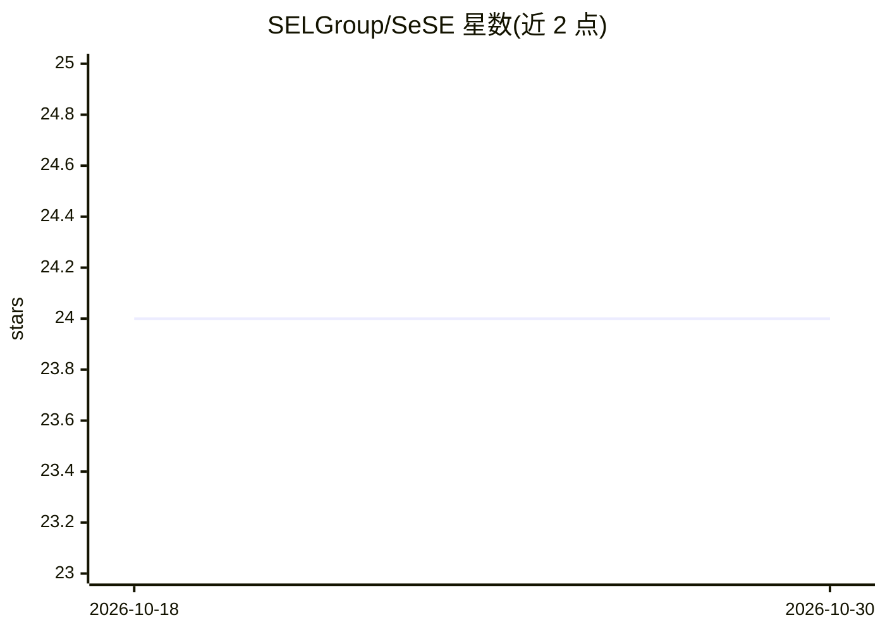

# SELGroup/SeSE

⭐ 24 · Python · 推送 2026-07-06 · [GitHub](https://github.com/SELGroup/SeSE) · 组织维护

**黑盒 LLM 不确定性量化框架：基于结构熵检测幻觉**

UAI 2026 Oral 论文的官方复现代码仓库，实现 Semantic Structural Entropy (SeSE) 方法：在不访问模型内部状态的前提下，对开放与闭源 LLM 的输出进行黑盒不确定性量化，用于检测生成文本中的幻觉。两个模块分别处理长文本（基于 claim-response 二部图与层级聚类结构熵 HCSE）与短文本 QA（BioASQ、TriviaQA、SQuAD 等数据集）。依赖 NVIDIA GPU 推理，句级实验调用 OpenAI API（GPT-5-Mini），BioASQ 数据需手动下载。

## 筛选速览

| 维度 | 判定 | 备注 |
|---|---|---|
| AI 角色 | `ai-native` | 本体是模型或模型工具 |
| 许可风险 | `none` | — |
| 部署形态 | `None` |  |
| 模型依赖 | — | README 未给出锁定关系 |
| 硬件要求 | — | 无带数字的原话,不猜 |
| 安装摩擦 | `low` | 无编译、无系统依赖或容器化 |
| 成熟度 | — | 结构信号不足 |

## 能力要点

- 黑盒不确定性量化，无需访问模型内部状态，兼容开源与闭源 LLM
- 长文本场景通过 claim-response 二部图计算 claim 级结构熵
- 短文本 QA 场景覆盖 BioASQ、TriviaQA、SQuAD 等数据集
- 理论证明 SeSE 在编码树退化为单层时恢复 Semantic Entropy

## 适用场景

- 复现论文中 24 个模型-数据集组合的不确定性量化实验
- 对 LLM 长文本输出做 claim 级幻觉检测研究
- 比较结构熵方法与语义熵等不确定性基线

## 场景标签

 · 领域:NLP/LLM 可靠性研究

## 证据(README 行号)

> L14: Large language models (LLMs) are increasingly deployed in safety-critical scenarios, yet they remain prone to **hal
> L31: 1. **Long-form uncertainty quantification** -- detects hallucinations and quantifies uncertainty in paragraph-level
> L32: 2. **Short-form generation uncertainty quantification** -- quantifies semantic uncertainty in standard QA tasks (Bi

## 星数曲线

2026-10-18 24 → 2026-10-30 24（+0）

---
*卡片 v1 · prompt 1.4 · 生成 2026-10-27 · 置信度 high · 依据 README sha `bba68c408958` · [字段定义](../../DATASET.md)*
