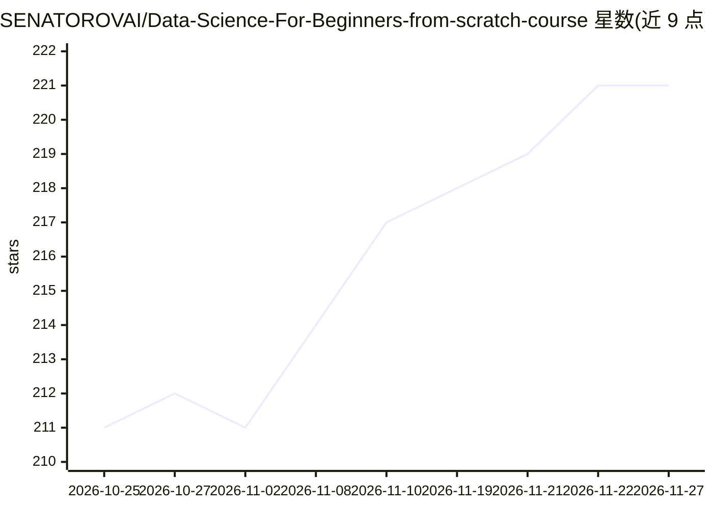

# SENATOROVAI/Data-Science-For-Beginners-from-scratch-course

⭐ 221 · Python · MIT · 推送 2026-11-24 · [GitHub](https://github.com/SENATOROVAI/Data-Science-For-Beginners-from-scratch-course) · [官网](https://SenatorovAI.com) · 组织维护

**数据科学从零到中级的学习课程资料库**

面向初学者的数据科学课程仓库，内容按 Python 基础、数据分析、统计学、机器学习模块组织，覆盖 NumPy/Pandas、回归与分类、梯度下降、正则化等主题，并包含房价预测等实践项目。README 顶部为俄文的课程改进日志（issue 修订记录），正文为英文介绍；未提供具体安装命令，技术栈列出 Python、Scikit-Learn、Jupyter Notebook 等，仓库由SenatorovAI 机构维护并附官网链接。

## 筛选速览

| 维度 | 判定 | 备注 |
|---|---|---|
| AI 角色 | `ai-knowledge` | 知识聚合/清单类 |
| 许可风险 | `permissive` | MIT |
| 部署形态 | `None` |  |
| 模型依赖 | — | README 未给出锁定关系 |
| 硬件要求 | — | 无带数字的原话,不猜 |
| 安装摩擦 | `low` | 无编译、无系统依赖或容器化 |
| 成熟度 | — | 结构信号不足 |

## 能力要点

- 结构化课程资料：Python、统计分析、机器学习基础到中级
- 覆盖线性/逻辑回归、梯度下降、L1/L2 正则化、决策树、KNN 等算法主题
- 包含房价预测、分类模型等实践项目
- 附俄文维护的 issue 修订与课程改进记录

## 适用场景

- 零基础系统学习数据科学与机器学习
- Python 开发者补充数学与 ML 基础
- 学生按模块练习回归、分类与数据分析项目

## 场景标签

`教程课程` · 领域:学习与行业

## 证据(README 行号)

> L54: > Beginner-friendly course and practical materials for learning Data Science from scratch with Python, Machine Lear
> L58: This repository contains structured materials, exercises, and practical examples for learning **Data Science from b
> L103: ## 📈 Topics Covered

## 星数曲线

2026-10-25 211 → 2026-11-27 221（+10）

---
*卡片 v1 · prompt 1.4 · 生成 2026-11-25 · 置信度 high · 依据 README sha `0ede2a410afe` · [字段定义](../../DATASET.md)*
