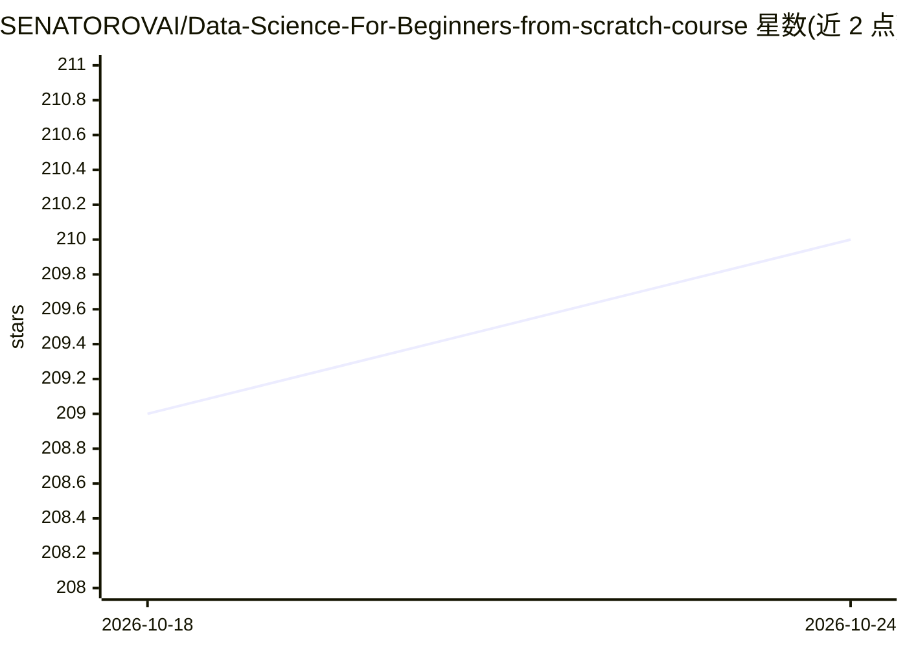

# SENATOROVAI/Data-Science-For-Beginners-from-scratch-course

⭐ 211 · Python · MIT · 推送 2026-10-23 · [GitHub](https://github.com/SENATOROVAI/Data-Science-For-Beginners-from-scratch-course) · [官网](https://SenatorovAI.com) · 组织维护

**从零学数据科学的课程与实践材料库**

面向初学者的 Data Science 学习仓库，内容覆盖 Python、NumPy/Pandas、数据可视化、统计（概率、假设检验、置信区间）与机器学习（线性/逻辑回归、梯度下降、正则化、决策树、KNN、模型评估），并配实践项目（房价预测、分类模型、真实数据集实验）。README 前半部分为俄语的仓库改进日志（课程勘误、作业与流程改进记录），主体课程说明为英语。以 Jupyter Notebook 等材料形式提供，无安装包或服务。

## 筛选速览

| 维度 | 判定 | 备注 |
|---|---|---|
| AI 角色 | `ai-knowledge` | 知识聚合/清单类 |
| 许可风险 | `permissive` | MIT |
| 部署形态 | `None` |  |
| 模型依赖 | — | README 未给出锁定关系 |
| 硬件要求 | — | 无带数字的原话,不猜 |
| 安装摩擦 | `low` | 无编译、无系统依赖或容器化 |
| 成熟度 | — | 结构信号不足 |

## 能力要点

- 覆盖 Python、统计与监督/无监督学习的分主题课程材料
- 含房价预测、分类模型等实践项目
- 线性回归、梯度下降等内容从零实现（from scratch）
- 记录大量课程勘误与改进的社区贡献日志

## 适用场景

- 零基础系统入门数据科学与机器学习
- Python 开发者补齐数学与 ML 基础
- 跟着真实数据集做练习项目

## 场景标签

`教程课程` · 领域:学习与行业

## 证据(README 行号)

> L54: > Beginner-friendly course and practical materials for learning Data Science from scratch with Python, Machine Lear
> L58: This repository contains structured materials, exercises, and practical examples for learning **Data Science from b

## 星数曲线

2026-10-18 209 → 2026-10-24 210（+1）

---
*卡片 v1 · prompt 1.4 · 生成 2026-10-22 · 置信度 high · 依据 README sha `750960e57667` · [字段定义](../../DATASET.md)*
