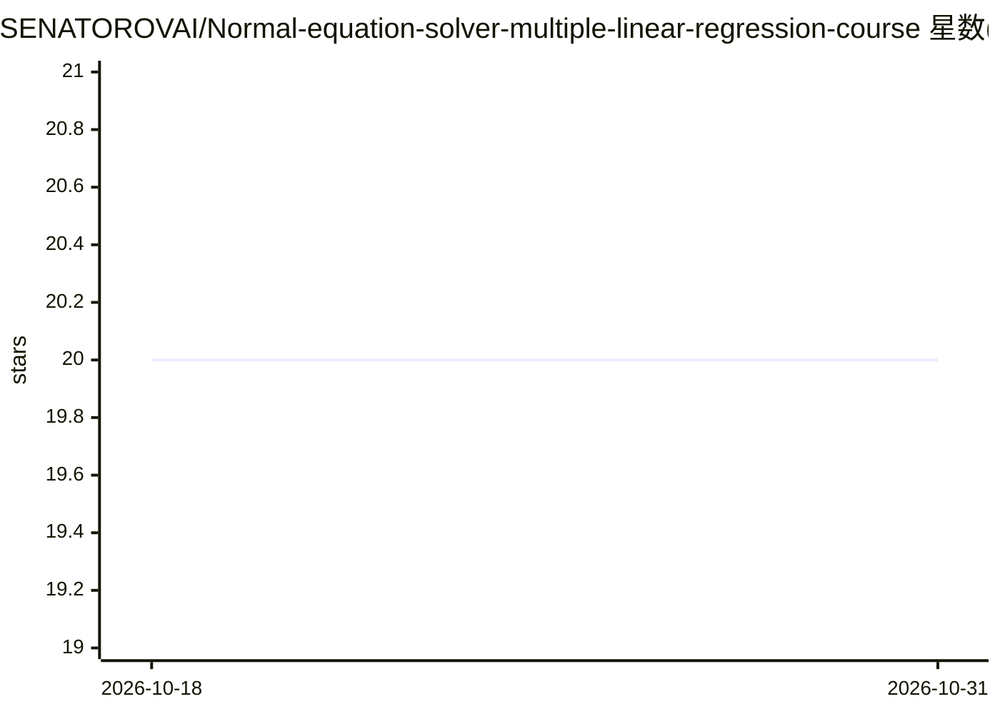

# SENATOROVAI/Normal-equation-solver-multiple-linear-regression-course

⭐ 20 · Jupyter Notebook · MIT · 推送 2026-03-17 · [GitHub](https://github.com/SENATOROVAI/Normal-equation-solver-multiple-linear-regression-course) · [官网](https://SenatorovAI.com) · 个人维护

**用正规方程闭式求解多元线性回归的 Python 研究实现**

面向研究与教学场景的多元线性回归闭式解实现：按 β = (XᵀX)⁻¹Xᵀy 的数学推导逐步展示梯度求导、正规方程建立与可逆性假设（rank(X)=p），并以显式矩阵运算实现最小二乘求解器，依赖仅为 NumPy。README 提供数学推导、假设条件与安装说明，通过 git clone 源码加 pip 安装依赖运行。适用范围以 XᵀX 可逆为前提，奇异矩阵情形无唯一解。

## 筛选速览

| 维度 | 判定 | 备注 |
|---|---|---|
| AI 角色 | `ai-native` | 本体是模型或模型工具 |
| 许可风险 | `permissive` | MIT |
| 部署形态 | `library` | 以包/库形式分发 |
| 模型依赖 | — | README 未给出锁定关系 |
| 硬件要求 | — | 无带数字的原话,不猜 |
| 安装摩擦 | `low` | 无编译、无系统依赖或容器化 |
| 成熟度 | — | 结构信号不足 |

## 能力要点

- 正规方程闭式解的显式矩阵实现
- 完整的数学推导（目标函数、梯度、正规方程）
- 仅依赖 NumPy，结构面向研究与教学

## 适用场景

- 学习正规方程法求解线性回归的推导过程
- 在教学中演示闭式最小二乘解
- 研究场景下复现可复现的闭式回归求解

## 场景标签

`教程课程` · 领域:学习与行业

## 证据(README 行号)

> L13: A research-oriented implementation of the **Normal Equations method** for solving the Multiple Linear Regression pr
> L17: This repository provides a mathematically explicit implementation of the Normal Equations approach for solving the 

## 星数曲线

2026-10-18 20 → 2026-10-31 20（+0）

---
*卡片 v1 · prompt 1.4 · 生成 2026-10-28 · 置信度 mid · 依据 README sha `3e117d20c49f` · [字段定义](../../DATASET.md)*
