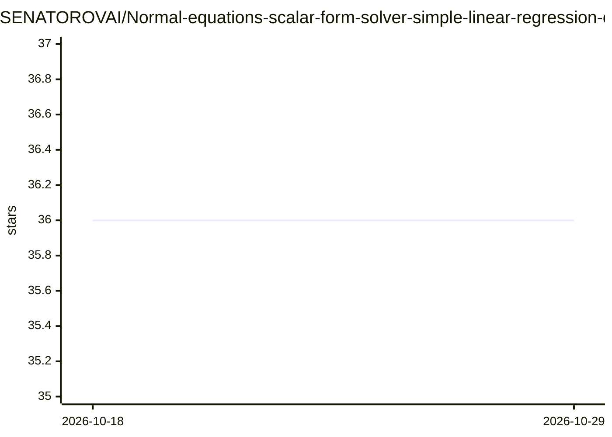

# SENATOROVAI/Normal-equations-scalar-form-solver-simple-linear-regression-course

⭐ 36 · Jupyter Notebook · MIT · 推送 2026-03-17 · [GitHub](https://github.com/SENATOROVAI/Normal-equations-scalar-form-solver-simple-linear-regression-course) · [官网](https://SenatorovAI.com) · 个人维护

**教学用：一元线性回归正规方程闭式解的 NumPy 求解器**

面向教学与研究的简单线性回归求解器实现：给出 OLS 目标函数、设计矩阵与标量形式闭式解的完整数学推导，并用 NumPy 按构造 X、计算 X^T X、矩阵求逆、估计系数四步实现 normal_equation 函数，输入标量序列 x、y 即返回截距与斜率。README 提示 X^T X 需非奇异，共线性或退化时可能出现数值不稳定，高维场景建议改用 QR 分解或 SVD 求解器。

## 筛选速览

| 维度 | 判定 | 备注 |
|---|---|---|
| AI 角色 | `ai-native` | 本体是模型或模型工具 |
| 许可风险 | `permissive` | MIT |
| 部署形态 | `None` |  |
| 模型依赖 | — | README 未给出锁定关系 |
| 硬件要求 | — | 无带数字的原话,不猜 |
| 安装摩擦 | `low` | 无编译、无系统依赖或容器化 |
| 成熟度 | — | 结构信号不足 |

## 能力要点

- 从最小二乘目标到闭式解的完整数学推导
- NumPy 实现 normal_equation(x, y) 返回截距与斜率
- 含矩阵形式与标量形式两种推导表达

## 适用场景

- 学习正规方程法求解简单线性回归
- 教学中演示 OLS 闭式解的推导与实现
- 对照标量公式与矩阵公式验证计算结果

## 场景标签

`教程课程` · 领域:学习与行业

## 证据(README 行号)

> L13: Research-oriented implementation of the **Normal Equations method** for solving **Simple Linear Regression** in clo
> L121: The solver is implemented using NumPy and performs:

## 星数曲线

2026-10-18 36 → 2026-10-29 36（+0）

---
*卡片 v1 · prompt 1.4 · 生成 2026-10-25 · 置信度 mid · 依据 README sha `8e10cf0aa559` · [字段定义](../../DATASET.md)*
