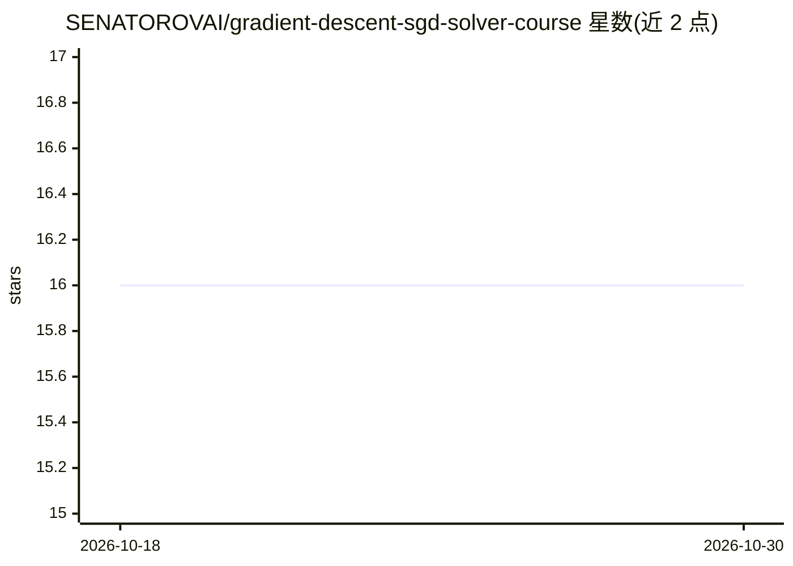

# SENATOROVAI/gradient-descent-sgd-solver-course

⭐ 16 · Jupyter Notebook · MIT · 推送 2026-03-17 · [GitHub](https://github.com/SENATOROVAI/gradient-descent-sgd-solver-course) · [官网](https://SenatorovAI.com) · 个人维护

**教学项目：用 Python 从零实现梯度下降与 SGD 求解器**

面向学习者的教育型代码仓库，演示梯度下降（GD）、随机梯度下降（SGD）与 Mini-Batch 变体的数学推导与 Python 实现，涵盖更新公式推导、收敛分析、优化可视化建议（损失曲线、参数收敛图、3D 损失面）。仓库给出基于 numpy 的示例实现，通过 requirements.txt 安装依赖并运行 examples/demo.py。定位为课程实现与作品集项目，非生产级优化库；可视化部分为推荐项而非已实现功能。

## 筛选速览

| 维度 | 判定 | 备注 |
|---|---|---|
| AI 角色 | `ai-knowledge` | 知识聚合/清单类 |
| 许可风险 | `permissive` | MIT |
| 部署形态 | `library` | 以包/库形式分发 |
| 模型依赖 | — | README 未给出锁定关系 |
| 硬件要求 | — | 无带数字的原话,不猜 |
| 安装摩擦 | `low` | 无编译、无系统依赖或容器化 |
| 成熟度 | — | 结构信号不足 |

## 能力要点

- GD / SGD / Mini-Batch 三种梯度下降变体的数学推导与实现
- 给出基于 numpy 的 gradient_descent 示例代码
- 包含收敛分析与推荐的可视化（损失曲线、3D 损失面）

## 适用场景

- 学习梯度下降类优化算法的数学原理与代码实现
- 作为机器学习课程作业或作品集项目参考
- 为线性/逻辑回归、神经网络训练理解底层优化过程

## 场景标签

`教程课程` · 领域:学习与行业

## 证据(README 行号)

> L13: > 🚀 Professional educational project for understanding and implementing **Gradient Descent and Stochastic Gradient 
> L91: This project explains the algorithm at a mathematical and implementation level.

## 星数曲线

2026-10-18 16 → 2026-10-30 16（+0）

---
*卡片 v1 · prompt 1.4 · 生成 2026-10-30 · 置信度 low · 依据 README sha `cb177d910a0b` · [字段定义](../../DATASET.md)*
