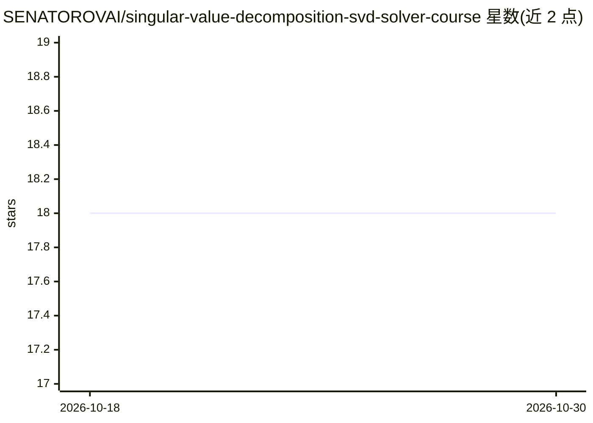

# SENATOROVAI/singular-value-decomposition-svd-solver-course

⭐ 18 · Python · MIT · 推送 2026-03-17 · [GitHub](https://github.com/SENATOROVAI/singular-value-decomposition-svd-solver-course) · [官网](https://SenatorovAI.com) · 个人维护

**面向学习者的 SVD 原理与 Python 从零实现课程项目**

教学型课程仓库，讲解奇异值分解（SVD）的数学推导、几何解释与从零的 Python 数值实现（基于 NumPy 的 SVDSolver 类），并覆盖低秩逼近、Eckart-Young 定理的 Frobenius 范数误差最小化等内容。面向学习线性代数与机器学习数值基础的开发者和学生。README 提供数学公式、项目目录结构与示例代码片段，应用场景包括降维、PCA、图像压缩、推荐系统与降噪。

## 筛选速览

| 维度 | 判定 | 备注 |
|---|---|---|
| AI 角色 | `ai-knowledge` | 知识聚合/清单类 |
| 许可风险 | `permissive` | MIT |
| 部署形态 | `None` |  |
| 模型依赖 | — | README 未给出锁定关系 |
| 硬件要求 | — | 无带数字的原话,不猜 |
| 安装摩擦 | `low` | 无编译、无系统依赖或容器化 |
| 成熟度 | — | 结构信号不足 |

## 能力要点

- SVD 数学推导与特征值连接（A=UΣVᵀ）的讲解
- 从零实现 SVDSolver 类的 Python 示例代码
- 低秩逼近与 Frobenius 范数最优性的数学说明
- 列举 PCA、图像压缩、推荐系统等应用场景

## 适用场景

- 学习 SVD 的数学原理与 Python 实现
- 理解低秩逼近在降维与压缩中的应用
- 作为机器学习数值线性代数的课程参考资料

## 场景标签

`教程课程` · 领域:学习与行业

## 证据(README 行号)

> L13: > 🚀 **Professional course project for understanding and implementing Singular Value Decomposition from scratch in P
> L23: - Applications in Machine Learning

## 星数曲线

2026-10-18 18 → 2026-10-30 18（+0）

---
*卡片 v1 · prompt 1.4 · 生成 2026-10-29 · 置信度 high · 依据 README sha `1e88601e7f5c` · [字段定义](../../DATASET.md)*
