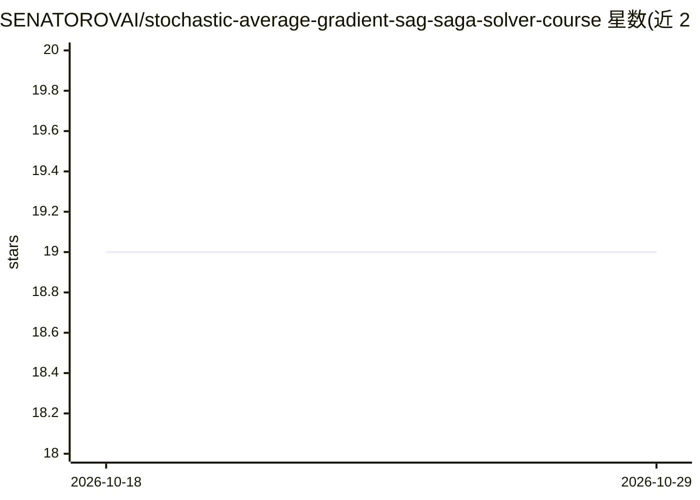

# SENATOROVAI/stochastic-average-gradient-sag-saga-solver-course

⭐ 19 · Python · MIT · 推送 2026-03-17 · [GitHub](https://github.com/SENATOROVAI/stochastic-average-gradient-sag-saga-solver-course) · [官网](https://SenatorovAI.com) · 个人维护

**SAG/SAGA 方差缩减优化算法的课程讲解与教学实现**

面向数据科学家、机器学习工程师与优化研究者的教学仓库：系统讲解 SAG（随机平均梯度）与 SAGA（无偏变体）算法的更新规则、收敛理论（强凸条件下线性收敛率 O((n+κ)log(1/ε)）与方差缩减原理，覆盖 Ridge/Lasso/逻辑回归等正则化经验风险最小化应用。附基于 NumPy 的最小 SAGA 教学实现与可运行的示例脚本，安装仅需 pip 安装 requirements。属理论讲解型仓库，非生产级求解器库。

## 筛选速览

| 维度 | 判定 | 备注 |
|---|---|---|
| AI 角色 | `ai-knowledge` | 知识聚合/清单类 |
| 许可风险 | `permissive` | MIT |
| 部署形态 | `library` | 以包/库形式分发 |
| 模型依赖 | — | README 未给出锁定关系 |
| 硬件要求 | — | 无带数字的原话,不猜 |
| 安装摩擦 | `low` | 无编译、无系统依赖或容器化 |
| 成熟度 | — | 结构信号不足 |

## 能力要点

- SAG 与 SAGA 算法的数学推导与更新规则讲解
- 收敛理论对比：线性收敛率 vs SGD 次线性速率
- 基于 NumPy 的最小 SAGA 教学实现与可运行示例
- 应用于逻辑回归、Ridge/Lasso 等正则化问题

## 适用场景

- 学习方差缩减类随机优化算法的原理与证明
- 理解 SAG/SAGA 在 scikit-learn 类库中的求解背景
- 运行教学示例观察算法收敛行为

## 场景标签

`教程课程` · 领域:学习与行业

## 证据(README 行号)

> L17: This project provides a professional and mathematically rigorous explanation of:
> L255: If you are studying **stochastic optimization algorithms for machine learning**, this repository provides both the

## 星数曲线

2026-10-18 19 → 2026-10-29 19（+0）

---
*卡片 v1 · prompt 1.4 · 生成 2026-10-28 · 置信度 high · 依据 README sha `aa4e9222c24c` · [字段定义](../../DATASET.md)*
