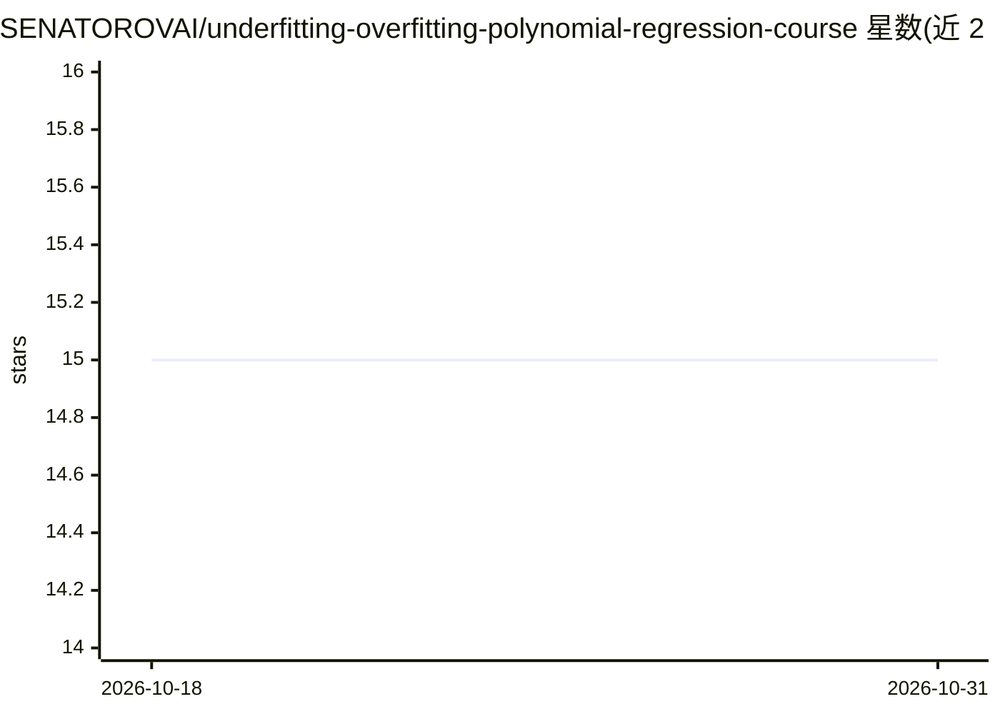

# SENATOROVAI/underfitting-overfitting-polynomial-regression-course

⭐ 15 · Python · MIT · 推送 2026-03-17 · [GitHub](https://github.com/SENATOROVAI/underfitting-overfitting-polynomial-regression-course) · [官网](https://SenatorovAI.com) · 个人维护

**讲解欠拟合/过拟合与多项式回归的数学教程仓库**

面向数据科学学生与机器学习工程师的概念讲解仓库：以多项式回归为主线，用数学推导与示例解释欠拟合、过拟合、偏差-方差权衡、Ridge/Lasso 正则化与模型复杂度，给出 OLS 闭式解、正则化目标函数与避免过拟合的实践建议，末尾附一段使用 numpy/sklearn 的 Ridge 多项式回归代码示例。内容为文档形式，未提供可运行工程或安装步骤。

## 筛选速览

| 维度 | 判定 | 备注 |
|---|---|---|
| AI 角色 | `ai-knowledge` | 知识聚合/清单类 |
| 许可风险 | `permissive` | MIT |
| 部署形态 | `None` |  |
| 模型依赖 | — | README 未给出锁定关系 |
| 硬件要求 | — | 无带数字的原话,不猜 |
| 安装摩擦 | `low` | 无编译、无系统依赖或容器化 |
| 成熟度 | — | 结构信号不足 |

## 能力要点

- 覆盖欠拟合/过拟合/偏差-方差/正则化的数学推导
- 给出 OLS 与 Ridge 闭式解及 Lasso 目标函数
- 提供避免欠拟合与过拟合的实践建议清单
- 附 numpy/sklearn Python 实现示例片段

## 适用场景

- 学习多项式回归中欠拟合与过拟合的数学原理
- 复习偏差-方差权衡与 Ridge/Lasso 正则化
- 作为监督学习理论的入门参考资料

## 场景标签

`教程课程` · 领域:学习与行业

## 证据(README 行号)

> L17: This repository explains the fundamental concepts of:
> L242: # 🎯 Target Audience

## 星数曲线

2026-10-18 15 → 2026-10-31 15（+0）

---
*卡片 v1 · prompt 1.4 · 生成 2026-10-30 · 置信度 high · 依据 README sha `47eafab7d194` · [字段定义](../../DATASET.md)*
