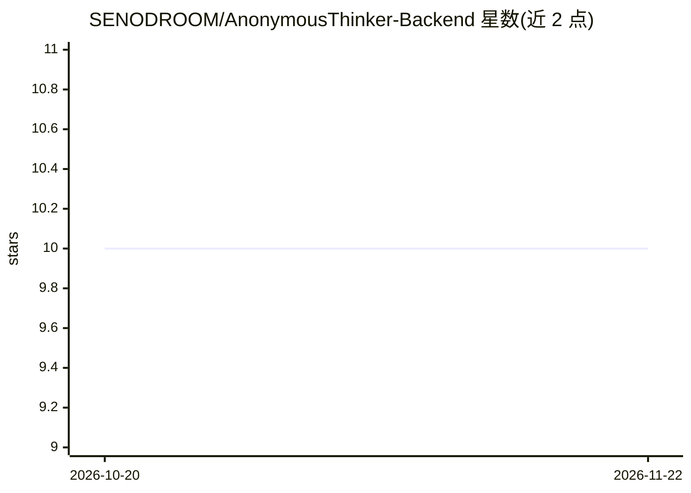

# SENODROOM/AnonymousThinker-Backend

⭐ 10 · JavaScript · 推送 2026-06-03 · [GitHub](https://github.com/SENODROOM/AnonymousThinker-Backend) · [官网](https://anoymous-thinker-api.vercel.app) · 个人维护

**宗教比较领域 RAG 知识问答后端：检索书籍段落作答并引用来源**

Node.js 后端，实现面向比较宗教的对话服务：管理员上传 PDF/TXT 书籍后，系统抽取文本、按段落切分为约 500 词的块、存入 MongoDB 并以 multilingual-e5-large 生成嵌入写入 Pinecone；用户提问时检索得分最高的 7 个片段注入 system prompt，回答附带来源文件名。提供 persona 配置、训练流程与完整 REST API；训练与知识库功能仅限 Admin 角色，部署支持本地 npm 运行或 Vercel。

## 筛选速览

| 维度 | 判定 | 备注 |
|---|---|---|
| AI 角色 | `ai-native` | 本体是模型或模型工具 |
| 许可风险 | `none` | — |
| 部署形态 | `library` | 以包/库形式分发 |
| 模型依赖 | locked-api |  |
| 硬件要求 | — | 无带数字的原话,不猜 |
| 安装摩擦 | `low` | 无编译、无系统依赖或容器化 |
| 成熟度 | — | 结构信号不足 |

## 能力要点

- Pinecone 语义检索 RAG 流水线（score > 0.45 取 7 个片段）
- PDF/TXT 上传后自动切块、嵌入并索引
- persona 配置与结构化推理 system prompt
- 回答附带来源引用与完整 REST API

## 适用场景

- 上传宗教学书籍构建可检索的问答知识库
- 向 AI 提问并获得带来源引用的比较宗教回答
- 通过 API 集成对话与知识管理功能

## 场景标签

`RAG` `文档问答` · 领域:知识与检索

## 证据(README 行号)

> L6: AnonymousThinker is an AI designed to defend Islamic truth through logic, historical evidence, and deep knowledge of
> L56: When a user sends a message, the backend queries Pinecone for the 7 most semantically relevant passages (score > 0.

## 星数曲线

2026-10-20 10 → 2026-11-22 10（+0）

---
*卡片 v1 · prompt 1.4 · 生成 2026-11-20 · 置信度 high · 依据 README sha `c3ac1d4007c7` · [字段定义](../../DATASET.md)*
