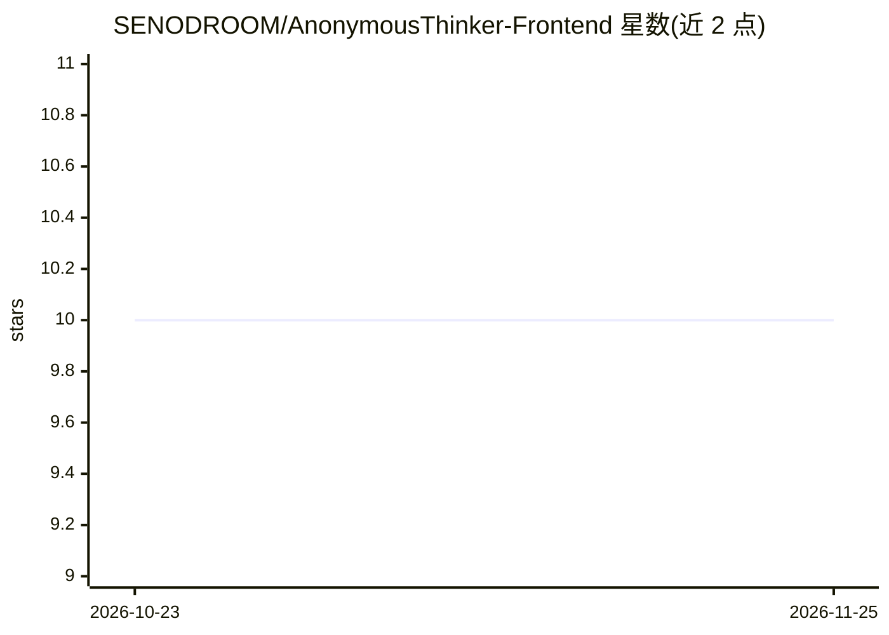

# SENODROOM/AnonymousThinker-Frontend

⭐ 10 · JavaScript · 推送 2026-06-03 · [GitHub](https://github.com/SENODROOM/AnonymousThinker-Frontend) · [官网](https://anoymous-thinker.vercel.app) · 个人维护

**宗教比较问答 AI 应用的 React 前端，含管理端知识库训练**

AnonymousThinker 的 React 前端，为用户提供与后端 AI 对话的界面，并含管理员的 Train AI 页面。用户消息经后端查询 Pinecone 语义检索上传书籍片段、注入上下文，由 Groq 的 llama-3.3-70b 生成带来源引用的回答。管理员可配置 Persona、上传 PDF/TXT 书籍（自动切块、存入 MongoDB、向量化到 Pinecone）并重建索引。需自行部署后端（端口 5000），前端支持 Vercel/Netlify 部署。

## 筛选速览

| 维度 | 判定 | 备注 |
|---|---|---|
| AI 角色 | `ai-native` | 本体是模型或模型工具 |
| 许可风险 | `none` | — |
| 部署形态 | `library` | 以包/库形式分发 |
| 模型依赖 | locked-api |  |
| 硬件要求 | — | 无带数字的原话,不猜 |
| 安装摩擦 | `low` | 无编译、无系统依赖或容器化 |
| 成熟度 | — | 结构信号不足 |

## 能力要点

- 聊天界面支持 Markdown 渲染与来源文件引用展示
- 管理员可上传 PDF/TXT 书籍并触发向量化索引流程
- Pinecone 状态面板显示检索方式并支持一键重建索引
- Persona 配置页面定义 AI 身份与推理策略

## 适用场景

- 为已部署的 AnonymousThinker 后端提供网页聊天入口
- 管理员上传宗教与哲学书籍扩充知识库
- 按主题建议卡片（逻辑/宗教比较/历史/哲学）快速开始对话

## 场景标签

`聊天机器人` `文档问答` `RAG` · 领域:对话与助手

## 证据(README 行号)

> L3: The React frontend for AnonymousThinker — an AI built to defend Islamic truth through logic, historical evidence, an
> L51: 2. Backend queries Pinecone for the most relevant passages from uploaded books

## 星数曲线

2026-10-23 10 → 2026-11-25 10（+0）

---
*卡片 v1 · prompt 1.4 · 生成 2026-11-20 · 置信度 high · 依据 README sha `8d691c145d31` · [字段定义](../../DATASET.md)*
