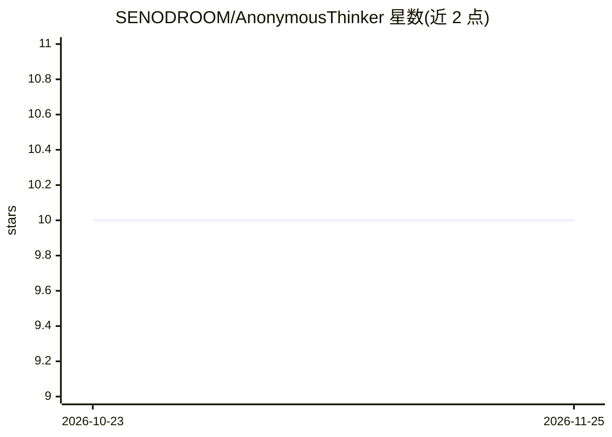

# SENODROOM/AnonymousThinker

⭐ 10 · 推送 2026-04-02 · [GitHub](https://github.com/SENODROOM/AnonymousThinker) · 个人维护

**面向宗教学问答的 AI 推理平台，重点回应伊斯兰教义问题**

基于 MERN 栈（React + Node/Express + MongoDB + JWT）的对话平台，管理员可定义 AI 人设与逻辑框架，通过上传 PDF/文本构建 RAG 知识库，仅授权开发者可训练模型或修改核心指令。支持双模型并排对比（Llama 3.1 8B 与 DeepSeek-R1-70B），推理经由 Groq API 与 Hugging Face Serverless Inference。v2.1 加入会话置顶/归档/搜索、消息评分、Markdown 导出等会话管理功能。本地部署需 Node.js 18+ 与 MongoDB。

## 筛选速览

| 维度 | 判定 | 备注 |
|---|---|---|
| AI 角色 | `ai-native` | 本体是模型或模型工具 |
| 许可风险 | `none` | — |
| 部署形态 | `library` | 以包/库形式分发 |
| 模型依赖 | locked-api |  |
| 硬件要求 | — | 无带数字的原话,不猜 |
| 安装摩擦 | `low` | 无编译、无系统依赖或容器化 |
| 成熟度 | — | 结构信号不足 |

## 能力要点

- 双模型并排对比回答（Llama 3.1 8B 与 DeepSeek-R1-70B）
- 管理员上传 PDF/文本构建 RAG 知识库
- 会话置顶、归档、搜索与 Markdown 导出
- 管理员通过 makeAdmin 脚本与 Core 逻辑配置控制 AI 人设

## 适用场景

- 以对话方式获取围绕伊斯兰教义的推理式解答
- 搭建带知识库上传与权限管理的自托管 AI 问答站
- 对比两个推理模型对同一问题的回答

## 场景标签

`RAG` `聊天机器人` · 领域:对话与助手

## 证据(README 行号)

> L3: AnonymousThinker is a premium AI reasoning platform designed to provide structured, logical responses with a special
> L26: - **Knowledge Base (RAG)**: Ground AI responses in scholarly Islamic knowledge by uploading PDFs and text files glo
> L35:  - **Inference**: Groq API & Hugging Face Serverless Inference.

## 星数曲线

2026-10-23 10 → 2026-11-25 10（+0）

---
*卡片 v1 · prompt 1.4 · 生成 2026-11-20 · 置信度 high · 依据 README sha `494f32a1d1b2` · [字段定义](../../DATASET.md)*
