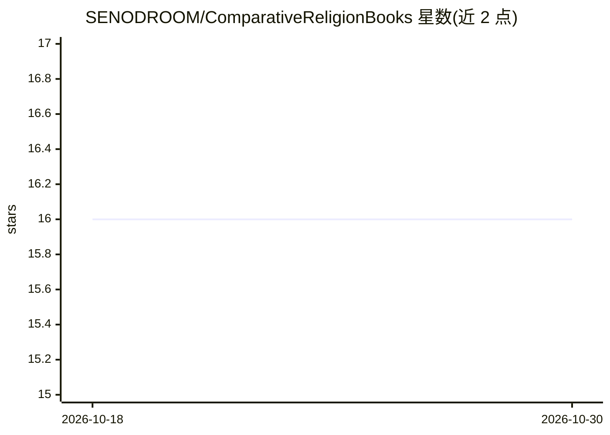

# SENODROOM/ComparativeReligionBooks

⭐ 16 · JavaScript · 推送 2026-08-02 · [GitHub](https://github.com/SENODROOM/ComparativeReligionBooks) · 个人维护

**伊斯兰视角的比较宗教学术书籍 PDF 策展图书馆**

社区驱动的数字图书馆仓库，收录比较宗教领域的学术 PDF，聚焦阐明、辩护伊斯兰立场的著作，主题覆盖伊斯兰神学与哲学、跨宗教比较分析、世界宗教史与护教学。所有书籍存于 /library 目录，通过 GitHub Pull Request 贡献：每次 PR 须恰好提交 5 本 PDF，命名要求 title-author 小写连字符格式，维护者审阅周期通常 3–7 天。面向学生、研究者与一般读者。

## 筛选速览

| 维度 | 判定 | 备注 |
|---|---|---|
| AI 角色 | `ai-knowledge` | 知识聚合/清单类 |
| 许可风险 | `none` | — |
| 部署形态 | `None` |  |
| 模型依赖 | — | README 未给出锁定关系 |
| 硬件要求 | — | 无带数字的原话,不猜 |
| 安装摩擦 | `low` | 无编译、无系统依赖或容器化 |
| 成熟度 | — | 结构信号不足 |

## 能力要点

- 按主题组织的 PDF 书籍库（library 目录）
- 标准化 PR 贡献流程（每次 5 本、命名规范、去重要求）
- 收录范围限定为捍卫或支持伊斯兰内容的著作

## 适用场景

- 查找伊斯兰视角的比较宗教研究书籍
- 为宗教学、护教学研究收集 PDF 文献
- 通过 PR 向图书馆贡献书籍

## 场景标签

`精选清单` · 领域:学习与行业

## 证据(README 行号)

> L10: _A curated open library exploring religion through an Islamic lens_
> L21: **ComparativeReligionBooks** is a community-driven digital library housing scholarly works on comparative religion,
> L36: The `/library` folder contains peer-reviewed and community-contributed PDFs covering:

## 星数曲线

2026-10-18 16 → 2026-10-30 16（+0）

---
*卡片 v1 · prompt 1.4 · 生成 2026-10-30 · 置信度 high · 依据 README sha `3a16314b8bf8` · [字段定义](../../DATASET.md)*
