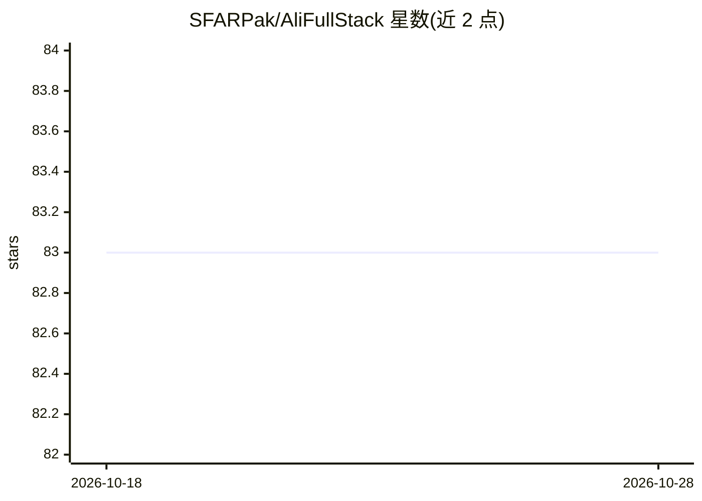

# SFARPak/AliFullStack

⭐ 83 · TypeScript · Apache-2.0 · 推送 2026-09-07 · [GitHub](https://github.com/SFARPak/AliFullStack) · 组织维护

**本地优先的开源全栈 AI 应用构建器，用 LLM 生成前后端代码**

基于 Electron 的本地运行应用构建器：用户自带 LLM API key，由 AI 生成前端（React/Next.js/Vue）与后端（Django/FastAPI/Flask/Node.js）代码、测试与自改进流水线，支持自主端到端开发并在关键点允许人工干预。已接入 OpenAI、Gemini、Claude、OpenRouter、Azure、Bedrock、xAI 等模型，无云依赖与数据上传。开发安装需 Node.js 20+，克隆仓库后 npm 安装、建 userData 目录、执行数据库迁移并以 npm start 启动；正式下载入口标注 Coming Soon，部分功能（拖拽 UI、协作编辑等）仍在路线图中。

## 筛选速览

| 维度 | 判定 | 备注 |
|---|---|---|
| AI 角色 | `ai-ecosystem` | LLM/agent 周边工具 |
| 许可风险 | `permissive` | Apache-2.0 |
| 部署形态 | `library` | 以包/库形式分发 |
| 模型依赖 | locked-api |  |
| 硬件要求 | — | 无带数字的原话,不猜 |
| 安装摩擦 | `low` | 无编译、无系统依赖或容器化 |
| 成熟度 | — | 结构信号不足 |

## 能力要点

- 自带 API Key 接入 OpenAI/Claude/Gemini/OpenRouter/Azure/Bedrock/xAI 等多家模型
- AI 自主全栈开发：前端到后端自动化、代码审查、人工干预点与进度跟踪
- 框架无关：支持 React/Next.js/Vue 与 Django/FastAPI/Flask/Node.js 等
- 本地运行，Electron 应用，Apache 2.0 许可

## 适用场景

- 在本地用自然语言驱动 AI 生成全栈应用的代码与测试
- 不愿被云厂商锁定、注重数据隐私的开发者自托管构建工具
- 按项目需要切换不同 LLM 提供商（BYO API Key）来生成代码

## 场景标签

`代码生成` `代码审查` `编码 Agent` · 领域:编码与开发

## 证据(README 行号)

> L35: - 🧠 **LLM-Powered Autonomy** — AI generates frontend, backend, tests, and more.
> L36: - 🧰 **Bring Your Own API Keys** — Works with OpenAI, Claude, Gemini, etc.

## 星数曲线

2026-10-18 83 → 2026-10-28 83（+0）

---
*卡片 v1 · prompt 1.4 · 生成 2026-10-24 · 置信度 high · 依据 README sha `e5d24d1b3310` · [字段定义](../../DATASET.md)*
