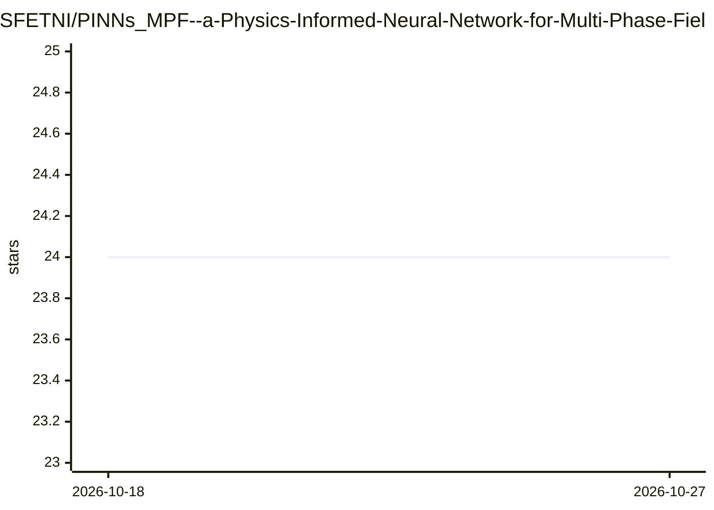

# SFETNI/PINNs_MPF--a-Physics-Informed-Neural-Network-for-Multi-Phase-Field-problems

⭐ 24 · Python · MIT · 推送 2026-08-30 · [GitHub](https://github.com/SFETNI/PINNs_MPF--a-Physics-Informed-Neural-Network-for-Multi-Phase-Field-problems) · 个人维护

**物理信息神经网络求解多相场微结构演化的科研代码**

PINNs-MPF 是随论文（Elfetni & Darvishi Kamachali, EABE 176 (2025) 106200）发布的仿真框架，用时空分解的物理信息神经网络求解多相场微观组织演化：2D 周期域划分为重叠空间子域，每子域一个 worker 网络，按时间窗推进；softmax 输出构造性保证相分数和为 1，内部连续与周期缝合条件拼接全域。本版本在 GPU 上以双精度原生运行。包含 B1–B5 五个基准的验证结果（对照解析解或有限差分参考），并披露局限（快速弛豫初始段、近消亡过收缩）。

## 筛选速览

| 维度 | 判定 | 备注 |
|---|---|---|
| AI 角色 | `ai-native` | 本体是模型或模型工具 |
| 许可风险 | `permissive` | MIT |
| 部署形态 | `None` |  |
| 模型依赖 | — | README 未给出锁定关系 |
| 硬件要求 | — | 无带数字的原话,不猜 |
| 安装摩擦 | `low` | 无编译、无系统依赖或容器化 |
| 成熟度 | — | 结构信号不足 |

## 能力要点

- 时空分解：N×N worker 网络 + 时间窗推进求解刚性多相场问题
- softmax 输出使相分数 Σφ=1 由构造保证
- GPU 双精度原生运行，各基准对照解析/有限差分参考复验
- B5 四相三结点基准：final MSE 3.70e-4，角偏差 0.40 deg

## 适用场景

- 科研人员仿真晶界迁移、晶粒收缩、三相结弛豫等微观组织演化
- 验证 PINN 方法在大刚性相场问题上的可用性与局限
- 复现论文基准实验结果

## 场景标签

 · 领域:计算材料科学/科学机器学习

## 证据(README 行号)

> L3: PINNs-MPF solves multi-phase-field microstructure evolution with physics-informed
> L10: runs natively on GPU in double precision, and each spatial worker now emits all phase

## 星数曲线

2026-10-18 24 → 2026-10-27 24（+0）

---
*卡片 v1 · prompt 1.4 · 生成 2026-10-27 · 置信度 high · 依据 README sha `5146340b74b3` · [字段定义](../../DATASET.md)*
