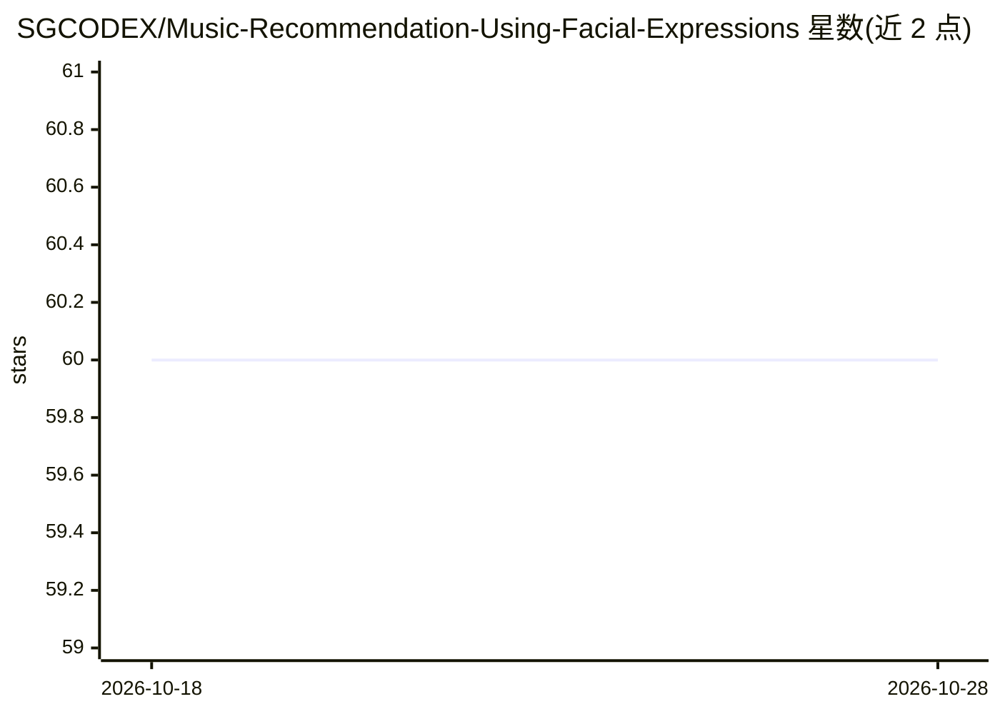

# SGCODEX/Music-Recommendation-Using-Facial-Expressions

⭐ 60 · Python · MIT · 推送 2026-01-22 · [GitHub](https://github.com/SGCODEX/Music-Recommendation-Using-Facial-Expressions) · [官网](https://music-recommendation-using-facial-expressions-latest.streamlit.app/) · 个人维护

**基于摄像头表情识别的情绪音乐推荐应用**

Python 应用：用 OpenCV 从摄像头实时检测人脸，再用预训练深度学习模型 fer2013_mini_XCEPTION（.hdf5）识别高兴、悲伤、愤怒、中性等情绪；点击屏幕时保存当前情绪，据此构造 YouTube 搜索查询并通过 webbrowser 模块在默认浏览器打开结果，requests 库辅助 API 交互。提供三种运行方式：Streamlit 网页、PySimpleGUI 桌面、CLI 终端。需连接摄像头，情感识别为预训练模型，不涉及训练流程。

## 筛选速览

| 维度 | 判定 | 备注 |
|---|---|---|
| AI 角色 | `ai-native` | 本体是模型或模型工具 |
| 许可风险 | `permissive` | MIT |
| 部署形态 | `library` | 以包/库形式分发 |
| 模型依赖 | — | README 未给出锁定关系 |
| 硬件要求 | — | 无带数字的原话,不猜 |
| 安装摩擦 | `low` | 无编译、无系统依赖或容器化 |
| 成熟度 | — | 结构信号不足 |

## 能力要点

- OpenCV 实时人脸检测与表情识别
- fer2013_mini_XCEPTION 预训练模型识别多种情绪
- 按情绪构造查询并在默认浏览器打开 YouTube 搜索结果
- 提供 Streamlit / PySimpleGUI 桌面 / CLI 三种界面

## 适用场景

- 我想根据当前情绪自动找到匹配的音乐
- 体验摄像头实时表情识别的演示应用
- 在其基础上更换或微调表情识别模型

## 场景标签

`人脸识别` `推荐系统` · 领域:学习与行业

## 证据(README 行号)

> L7: This project is a Python-based application that uses OpenCV for real-time facial detection and a pre-trained deep le
> L9: Once the emotion is detected, the application constructs a YouTube search query tailored to the identified mood. Usi

## 星数曲线

2026-10-18 60 → 2026-10-28 60（+0）

---
*卡片 v1 · prompt 1.4 · 生成 2026-10-24 · 置信度 high · 依据 README sha `ae86b9d097c7` · [字段定义](../../DATASET.md)*
