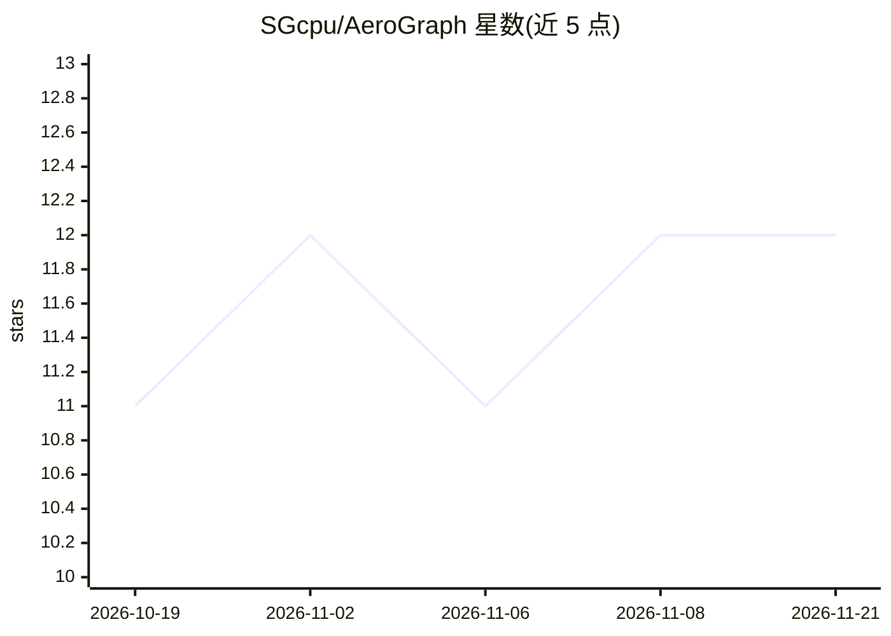

# SGcpu/AeroGraph

⭐ 12 · TypeScript · Apache-2.0 · 推送 2026-11-06 · [GitHub](https://github.com/SGcpu/AeroGraph) · 个人维护

**多智能体 AI 工作流的可观测与调试层：本地回放、环检测、轨迹分叉**

面向自主 AI 工作流的本地可观测性与调试层：以 10 类规范化事件将 prompt、响应、工具调用、检索、handoff、错误等捕获进 append-only 的 SQLite 存储；用 ReactFlow 图展示执行流，支持逐步回放、载荷检查与失败高亮；从任意 span 分叉出替代执行时间线并提供 Myers diff 对比；将模型/工具网络流量截获为确定性 cassette，实现零 token 成本回放；检测多智能体乒乓循环、无进展递归工具调用等失败模式并做根因归类；提供 TypeScript 与 Python SDK 及 LangChain 适配器、OTel 桥接。

## 筛选速览

| 维度 | 判定 | 备注 |
|---|---|---|
| AI 角色 | `ai-ecosystem` | LLM/agent 周边工具 |
| 许可风险 | `permissive` | Apache-2.0 |
| 部署形态 | `desktop` | 安装包/桌面程序 |
| 模型依赖 | — | README 未给出锁定关系 |
| 硬件要求 | — | 无带数字的原话,不猜 |
| 安装摩擦 | `low` | 无编译、无系统依赖或容器化 |
| 成熟度 | — | 结构信号不足 |

## 能力要点

- 10 类规范化事件写入 append-only SQLite 存储
- 确定性 cassette 回放，零 token 成本、<5ms/步
- Fork-and-Resume 与 Myers diff 差异对比
- 乒乓循环、无进展递归调用等失败模式检测与根因分类

## 适用场景

- 调试多智能体工作流中的死循环与工具滥用
- 不改代码重放历史 agent 执行并探索替代分支
- 分析 token 花费与缓存/回放节省比例
- 通过 OTel 导入导出接入现有遥测链路

## 场景标签

`LLM 可观测性` · 领域:评测与运维

## 证据(README 行号)

> L7:  Cognitive observability and debugging layer for autonomous AI workflows.
> L36: - **Normalized Agent Tracing**: Captures **prompts**, **responses**, **tool calls**, **tool results**, **retrievers
> L82:  In multi-agent architectures (LangGraph multi-agent, CrewAI, AutoGen, OpenAI Swarm), an agent rarely solves a comp

## 星数曲线

2026-10-19 11 → 2026-11-21 12（+1）

---
*卡片 v1 · prompt 1.4 · 生成 2026-11-19 · 置信度 high · 依据 README sha `8e72dd427885` · [字段定义](../../DATASET.md)*
