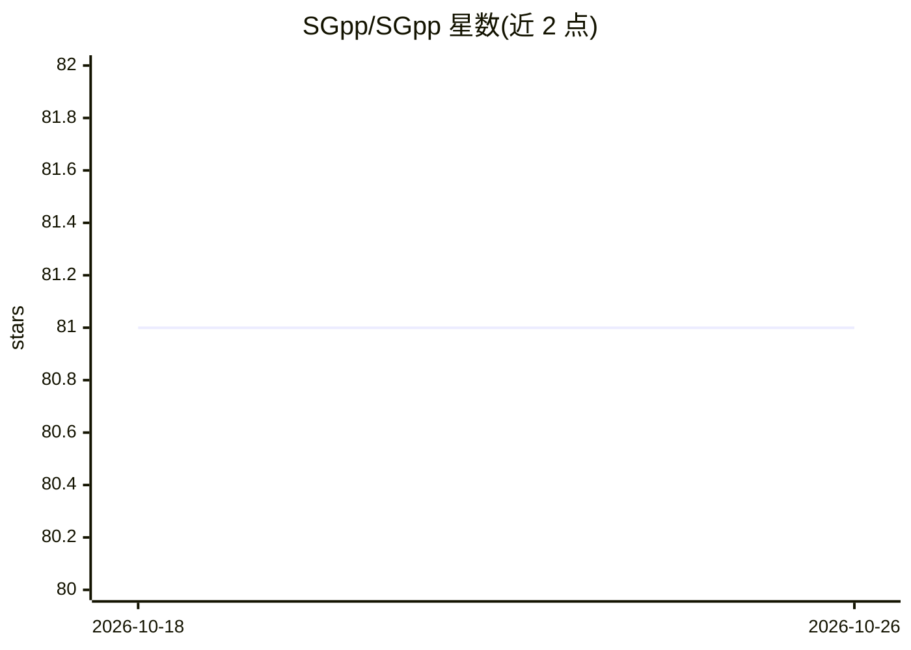

# SGpp/SGpp

⭐ 81 · C++ · NOASSERTION · 推送 2025-11-03 · [GitHub](https://github.com/SGpp/SGpp) · [官网](https://sgpp.sparsegrids.org) · 组织维护

**稀疏网格数值库：提供插值、求积、优化与机器学习算法**

C++ 编写并绑定 Python/Java/MATLAB 的稀疏网格（sparse grids）数值库与框架，支持层次化空间自适应稀疏网格与维度自适应组合技巧两类变体，覆盖插值、求积、优化、偏微分方程求解与机器学习/数据挖掘等应用场景。以库和框架形式提供给数值计算与科学计算开发者使用，免费但要求注明出处。Linux 提供 deb 二进制，含 MATLAB 支持，API 文档与教程见项目官网。

## 筛选速览

| 维度 | 判定 | 备注 |
|---|---|---|
| AI 角色 | `ai-native` | 本体是模型或模型工具 |
| 许可风险 | `none` | NOASSERTION |
| 部署形态 | `None` |  |
| 模型依赖 | — | README 未给出锁定关系 |
| 硬件要求 | — | 无带数字的原话,不猜 |
| 安装摩擦 | `low` | 无编译、无系统依赖或容器化 |
| 成熟度 | — | 结构信号不足 |

## 能力要点

- 支持层次化空间自适应与维度自适应两类稀疏网格
- 提供 C++/Python/Java/MATLAB 多语言接口
- 应用覆盖插值、求积、优化、PDE 与机器学习
- Linux deb 二进制与 MATLAB 支持随 releases 发布

## 适用场景

- 高维数值计算中的函数插值与求积
- 求解偏微分方程与优化问题
- 基于稀疏网格的回归/分类等数据挖掘任务

## 场景标签

 · 领域:科学计算/数值库

## 证据(README 行号)

> L9: SG⁺⁺ is a library and framework for sparse grids in different flavors.
> L10: SG⁺⁺ supports both hierarchical spatially-adaptive sparse grids and the

## 星数曲线

2026-10-18 81 → 2026-10-26 81（+0）

---
*卡片 v1 · prompt 1.4 · 生成 2026-10-24 · 置信度 mid · 依据 README sha `43ba01b1460c` · [字段定义](../../DATASET.md)*
