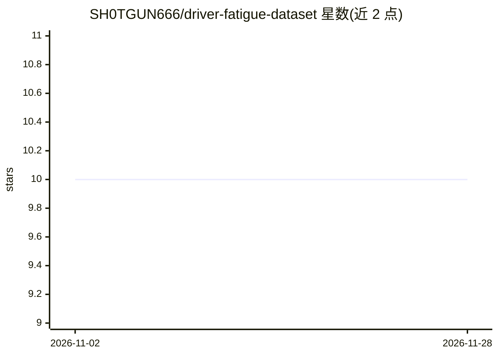

# SH0TGUN666/driver-fatigue-dataset

⭐ 10 · NOASSERTION · 推送 2026-11-02 · [GitHub](https://github.com/SH0TGUN666/driver-fatigue-dataset) · 组织维护 · 中文 README

**面向疲劳检测研究者的 7 类 YOLO 车内图像数据集**

发布 9,751 张模拟车内视角 JPEG 图像（640×640），带 CVAT 标注转出的 YOLO .txt 边界框，覆盖眼部、嘴部、头部姿态 7 类，按 8:1:1 划分 train/val/test；包含低光、强光、乘客、口罩、墨镜等干扰条件。数据以约 1 GB 压缩包经百度网盘分发，仓库文档说明类别表、目录结构、标签格式与论文引用。配套论文用 Ultralytics YOLO11 训练检测器，并比较阈值融合、滑动窗口评分与 YOLO11-LSTM 三种疲劳判定方式；训练平台为 Windows 11 + RTX 3090。论文超参与训练配置在文中多处表述不一致，README 已并列展示。

## 筛选速览

| 维度 | 判定 | 备注 |
|---|---|---|
| AI 角色 | `ai-knowledge` | 知识聚合/清单类 |
| 许可风险 | `none` | NOASSERTION |
| 部署形态 | `desktop` | 安装包/桌面程序 |
| 模型依赖 | — | README 未给出锁定关系 |
| 硬件要求 | — | 无带数字的原话,不猜 |
| 安装摩擦 | `low` | 无编译、无系统依赖或容器化 |
| 成熟度 | — | 结构信号不足 |

## 能力要点

- 9,751 张 640×640 车内图像，7 类 YOLO 标注，train/val/test 8:1:1 划分
- 覆盖低光、强光、乘客、口罩、墨镜等 6 种车内干扰条件
- 配套论文比较阈值融合、滑动窗口、YOLO11-LSTM 三种疲劳判定策略
- 以百度网盘约 1 GB 压缩包分发，CC BY 4.0 许可

## 适用场景

- 训练 YOLO11 做眼部/嘴部/头部姿态疲劳检测
- 研究时序特征融合的疲劳判定策略
- 需要含口罩、墨镜、乘客等干扰条件的车内检测数据

## 场景标签

`目标检测` · 领域:感知与多模态

## 证据(README 行号)

> L3: 驾驶员疲劳检测数据集：9,751 张模拟车内视角图像，7 类 YOLO 标注（眼部、嘴部、头部姿态），用于 YOLO11 多特征疲劳检测研究（IEEE ICEICT 2025）。
> L5: A public set of **9,751** JPEG images for vision-based driver fatigue detection. Each image is a simulated in-vehicl
> L19: |License|CC BY 4.0|

## 星数曲线

2026-11-02 10 → 2026-11-28 10（+0）

---
*卡片 v1 · prompt 1.4 · 生成 2026-11-20 · 置信度 high · 依据 README sha `a104e070fafa` · [字段定义](../../DATASET.md)*
