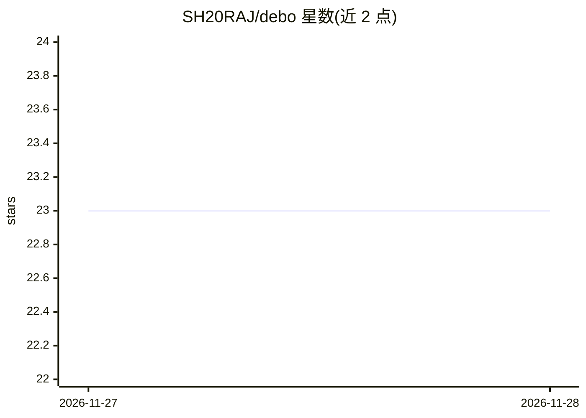

# SH20RAJ/debo

⭐ 23 · TypeScript · NOASSERTION · 推送 2026-11-04 · [GitHub](https://github.com/SH20RAJ/debo) · [官网](https://debo.life) · 个人维护

**个人记忆层：为 AI 助手收集并溯源检索你的生活上下文**

开源的个人记忆与上下文系统，将日记、笔记、文档与连接的外部上下文集中到用户自控的存储中，通过带出处的检索返回相关内容，并以 MCP 协议向兼容的 AI 客户端暴露授权记忆。TypeScript monorepo 架构：Next.js Web UI、LangGraph agent、Neon PostgreSQL、Cloudflare R2、Trigger.dev 后台任务与 Python 文档处理服务。README 明确声明当前主分支未经过完整可复现安装、测试与 CI 验证，生产就绪状态标记为 NOT VERIFIED，完成度估算约 2.0–2.5%。

## 筛选速览

| 维度 | 判定 | 备注 |
|---|---|---|
| AI 角色 | `ai-ecosystem` | LLM/agent 周边工具 |
| 许可风险 | `permissive` | NOASSERTION |
| 部署形态 | `None` |  |
| 模型依赖 | — | README 未给出锁定关系 |
| 硬件要求 | — | 无带数字的原话,不猜 |
| 安装摩擦 | `low` | 无编译、无系统依赖或容器化 |
| 成熟度 | `idea` | |

## 能力要点

- 通过 MCP 服务器向兼容 AI 客户端提供授权记忆
- 检索结果附带 provenance 出处供用户核验
- 授权在服务端代码强制执行，LLM 不作为权限判定者
- TypeScript monorepo：Next.js + LangGraph + Neon PostgreSQL + R2

## 适用场景

- 将日记与笔记集中为可查询的个人知识库
- 为多个 AI 工具提供统一的带出处个人上下文
- 自托管管理个人数据的隐私与工作区隔离

## 场景标签

`知识库管理` `Agent 记忆` · 领域:Agent 开发

## 证据(README 行号)

> L19: - **A portable context layer** — expose authorized memory to supported AI clients through the Model Context Protoco
> L76: MCP server ── authorized context for compatible AI clients
> L84: |Agent orchestration|LangGraph JS|Typed state graph and bounded tool routing|

## 星数曲线

2026-11-27 23 → 2026-11-28 23（+0）

---
*卡片 v1 · prompt 1.4 · 生成 2026-11-27 · 置信度 high · 依据 README sha `cf8588d2b75e` · [字段定义](../../DATASET.md)*
