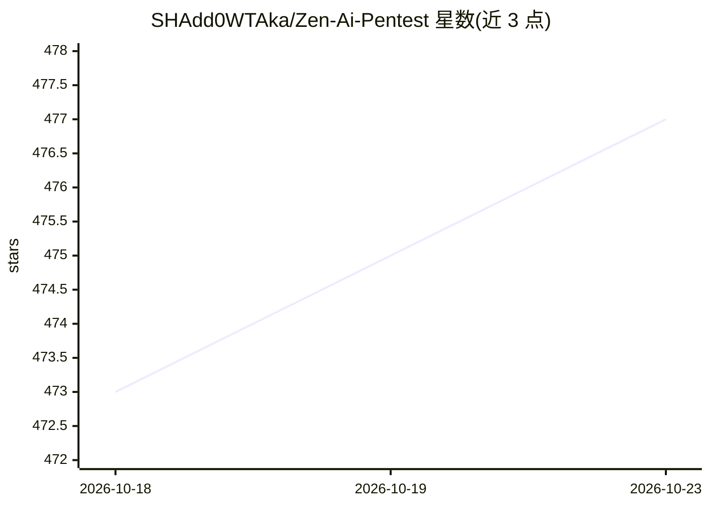

# SHAdd0WTAka/Zen-Ai-Pentest

⭐ 477 · Python · MIT · 推送 2026-10-22 · [GitHub](https://github.com/SHAdd0WTAka/Zen-Ai-Pentest) · [官网](https://shadd0wtaka.github.io/Zen-Ai-Pentest/) · 个人维护

**AI 驱动的自主渗透测试框架，集成 72+ 安全工具**

面向安全专业人员、漏洞赏金猎人与企业红队的自主渗透测试框架：以 ReAct 模式的 AI Agent 为核心，编排 nmap、Metasploit、SQLMap 等 72+ 安全工具执行侦察、扫描、利用与报告流程。提供 11 个专项 AI Persona、贝叶斯+多模型投票的误报削减、CVSS/EPSS 风险评分、Docker 沙箱隔离的漏洞验证、攻击路径图可视化与合规报告生成；另含 8 个 MCP 服务器、95 个技能模块、WhatsApp 机器人与 VPN Killswitch。部署支持 Docker Compose 全栈或 pip 本地安装，需配置 OPENCODE_API_KEY，通过 OmniRoute 调用免费模型。

## 筛选速览

| 维度 | 判定 | 备注 |
|---|---|---|
| AI 角色 | `ai-native` | 本体是模型或模型工具 |
| 许可风险 | `permissive` | MIT |
| 部署形态 | `self-host` | docker 或自建部署 |
| 模型依赖 | — | README 未给出锁定关系 |
| 硬件要求 | — | 无带数字的原话,不猜 |
| 安装摩擦 | `low` | 无编译、无系统依赖或容器化 |
| 成熟度 | — | 结构信号不足 |

## 能力要点

- ReAct 模式自主 Agent，编排 72+ 集成安全工具
- 11 个专项 AI Persona（侦察/利用/报告/云/ICS 等）
- 贝叶斯+多模型投票误报削减与 CVSS/EPSS 风险评分
- 8 个 MCP 服务器与 95 个技能模块

## 适用场景

- 对授权目标执行端到端自动化渗透测试并产出合规报告
- 红队用专项 Agent 做侦察、利用与攻击路径分析
- 通过 WhatsApp 命令远程发起安全扫描与 AI 安全问答

## 场景标签

`网络安全` · 领域:学习与行业

## 证据(README 行号)

> L22: **Zen-AI-Pentest** is an autonomous, AI-driven penetration testing framework that combines cutting-edge large langu
> L34: - **ReAct Pattern**: Reason → Act → Observe → Reflect
> L97: |`omni-ai`|AI chat via OmniRoute (free models)|chat, stream, vision, web_extract, list_models|

## 星数曲线

2026-10-18 473 → 2026-10-23 477（+4）

---
*卡片 v1 · prompt 1.4 · 生成 2026-10-21 · 置信度 high · 依据 README sha `6f8d40c94c47` · [字段定义](../../DATASET.md)*
