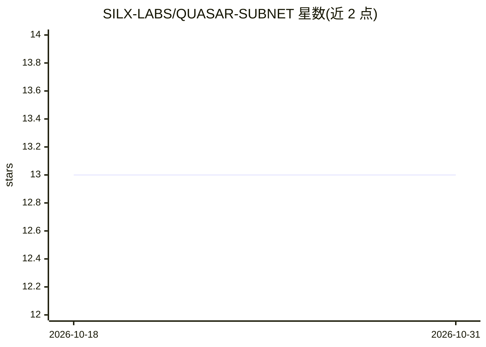

# SILX-LABS/QUASAR-SUBNET

⭐ 13 · Python · MIT · 推送 2026-06-26 · [GitHub](https://github.com/SILX-LABS/QUASAR-SUBNET) · 组织维护

**Bittensor 上 Quasar 模型去中心化持续预训练子网系统**

面向 Bittensor 子网（netuid 24，finney 网络）参与者的生产训练系统：将 Quasar Preview 基座模型的可训练张量切分为 24 个分片，由 orchestrator 向矿工分配训练租约，验证者校验并合并通过审核的活跃分片，定期发布更新后的检查点，目标完成 10T 追加预训练 token。奖励基于被接受的合并事件而非矿工自报数据。参与者通过 git clone 与角色脚本安装，矿工需 GPU（支持多卡），验证者用注册热钥发布权重。

## 筛选速览

| 维度 | 判定 | 备注 |
|---|---|---|
| AI 角色 | `ai-ecosystem` | LLM/agent 周边工具 |
| 许可风险 | `permissive` | MIT |
| 部署形态 | `library` | 以包/库形式分发 |
| 模型依赖 | — | README 未给出锁定关系 |
| 硬件要求 | — | 无带数字的原话,不猜 |
| 安装摩擦 | `low` | 无编译、无系统依赖或容器化 |
| 成熟度 | — | 结构信号不足 |

## 能力要点

- 模型张量切分 24 分片、租约分配、验证者审核合并的去中心化训练流程
- 奖励基于被接受的活跃合并事件，无效/重放/未签名声明零权重
- 基于签名 manifest 与受限授权的访问模型，而非通用操作员凭证
- 提供矿工/验证者安装脚本与 CLI（支持多 GPU 矿工）

## 适用场景

- 作为 Bittensor 矿工参与 Quasar 模型分布式预训练并获取激励
- 作为验证者审核训练工作并发布子网权重
- 研究去中心化大模型训练的分片合并与验证机制

## 场景标签

`模型训练` · 领域:训练与推理

## 证据(README 行号)

> L3: Quasar Training is the production training system for continuing Quasar model
> L21: splits the trainable model tensors into 24 fragments, assigns training leases to
> L28: - **Miner:** trains assigned Quasar data and uploads signed training artifacts.

## 星数曲线

2026-10-18 13 → 2026-10-31 13（+0）

---
*卡片 v1 · prompt 1.4 · 生成 2026-10-31 · 置信度 high · 依据 README sha `d2138122f08c` · [字段定义](../../DATASET.md)*
