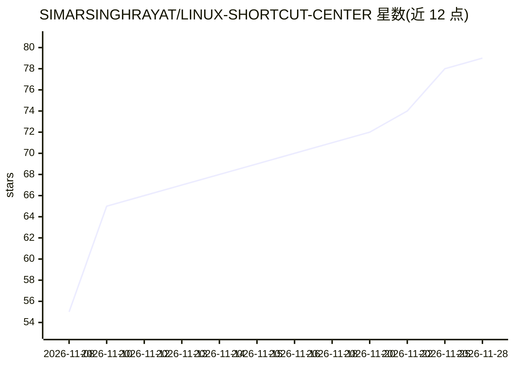

# SIMARSINGHRAYAT/LINUX-SHORTCUT-CENTER

⭐ 79 · TypeScript · MIT · 推送 2026-11-09 · [GitHub](https://github.com/SIMARSINGHRAYAT/LINUX-SHORTCUT-CENTER) · [官网](https://linux-shortcut-center.vercel.app) · 个人维护

**Linux 终端命令与 AI 桌面应用安装指引的策展中心**

面向 Linux 开发者与系统工程师的桌面应用与命令仓库：提供在 Debian 13（Trixie, x86_64）上经过验证的终端命令、10 款 AI 桌面应用（ChatGPT、Claude、Grok、Gemini 等）与 6 款浏览器的安装指引，按类别分块组织，支持一键复制命令到剪贴板、步骤勾选确认与 GitHub OAuth 登录。所有命令均在目标平台预先验证，用户自行在终端以自身权限执行。仓库不含模型推理功能，AI 内容以安装指引形式存在。

## 筛选速览

| 维度 | 判定 | 备注 |
|---|---|---|
| AI 角色 | `ai-knowledge` | 知识聚合/清单类 |
| 许可风险 | `permissive` | MIT |
| 部署形态 | `None` |  |
| 模型依赖 | — | README 未给出锁定关系 |
| 硬件要求 | — | 无带数字的原话,不猜 |
| 安装摩擦 | `low` | 无编译、无系统依赖或容器化 |
| 成熟度 | — | 结构信号不足 |

## 能力要点

- 10 款 AI 桌面应用在 Debian 13 上的经验证安装指引
- Chrome/Firefox ESR/Brave/Edge/Opera/Chromium 浏览器仓库与 GPG 配置指引
- 一键复制命令到剪贴板与交互式步骤勾选确认
- GitHub OAuth 集成对接 Linux App Center 门户

## 适用场景

- 在新装 Debian 系统上快速完成 AI 桌面应用与浏览器的安装
- 查找经过验证的 Linux 终端命令而不用翻论坛
- 按类别浏览并一键复制生产可用的命令

## 场景标签

`精选清单` · 领域:学习与行业

## 证据(README 行号)

> L21: **LINUX SHORTCUT CENTER** is an interactive, zero-friction desktop application and verified command repository desi
> L29: - 🤖 **Turnkey AI Desktop Workspace**: Get 10 leading AI desktop apps up and running in minutes without hunting down
> L36: ### 🤖 10 AI Desktop Apps on Debian 13

## 星数曲线

2026-11-08 55 → 2026-11-28 79（+24）

---
*卡片 v1 · prompt 1.4 · 生成 2026-11-18 · 置信度 mid · 依据 README sha `eeef5aeca411` · [字段定义](../../DATASET.md)*
