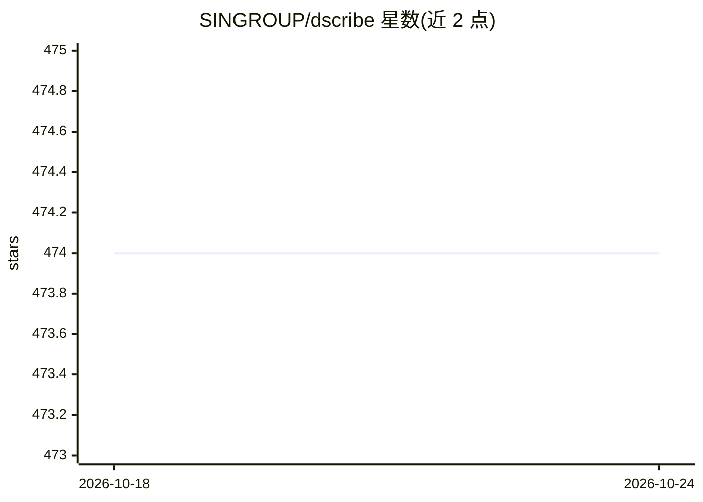

# SINGROUP/dscribe

⭐ 474 · C++ · Apache-2.0 · 推送 2026-04-18 · [GitHub](https://github.com/SINGROUP/dscribe) · [官网](https://singroup.github.io/dscribe/) · 组织维护

**将原子结构转为定长数值描述符的 Python 库**

面向材料科学与机器学习场景的 Python 包：读取原子结构，生成 SOAP、MBTR、ACSF、Coulomb 矩阵等多种定长描述符及导数，可用于机器学习、可视化与相似性分析等任务。基于 ASE 构建原子体系，支持 pip、conda 与源码编译三种安装方式。描述符为材料建模特征工程的输入，不直接产出模型预测结果。

## 筛选速览

| 维度 | 判定 | 备注 |
|---|---|---|
| AI 角色 | `ai-ecosystem` | LLM/agent 周边工具 |
| 许可风险 | `permissive` | Apache-2.0 |
| 部署形态 | `library` | 以包/库形式分发 |
| 模型依赖 | — | README 未给出锁定关系 |
| 硬件要求 | — | 无带数字的原话,不猜 |
| 安装摩擦 | `low` | 无编译、无系统依赖或容器化 |
| 成熟度 | — | 结构信号不足 |

## 能力要点

- 支持 8 种描述符（Coulomb/Sine/Ewald 矩阵、ACSF、SOAP、MBTR、LMBTR、Valle-Oganov）
- 各描述符均支持导数计算
- 配合 ASE 构建原子体系使用

## 适用场景

- 为材料机器学习模型生成原子结构的特征向量
- 对原子体系做可视化或相似性分析
- 科研中复现文献中的描述符方法

## 场景标签

`科研工具` · 领域:学习与行业

## 证据(README 行号)

> L5: DScribe is a Python package for transforming atomic structures into fixed-size
> L7: they can be used in various tasks, including machine learning, visualization,

## 星数曲线

2026-10-18 474 → 2026-10-24 474（+0）

---
*卡片 v1 · prompt 1.4 · 生成 2026-10-21 · 置信度 high · 依据 README sha `c76b471d0bcd` · [字段定义](../../DATASET.md)*
