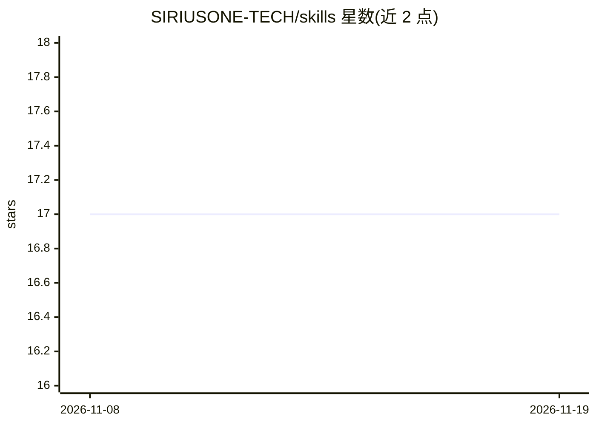

# SIRIUSONE-TECH/skills

⭐ 17 · MIT · 推送 2026-11-05 · [GitHub](https://github.com/SIRIUSONE-TECH/skills) · [官网](https://siriusone.com) · 组织维护

**面向企业领导者的 AI 转型咨询对话式 agent 技能包**

SiriusOne 公司发布的 Agent Skills 仓库，遵循 Agent Skills 格式（SKILL.md + 可选 references/scripts），兼容 Claude Code、Codex、Cursor、Gemini CLI 等 agent。当前包含 start-ai-journey 技能：通过引导式发现对话，帮助创始人、技术与业务领导者把想法或业务问题转化为 Discovery Brief 或 Exploration Summary，覆盖 AI 原生产品开发、AI 转型与遗留系统现代化三个方向，可转接 SiriusOne 专家。技能仅引导对话，不代为构建软件或提交表单。安装需 Node.js 22.20+，通过 npx skills 安装。

## 筛选速览

| 维度 | 判定 | 备注 |
|---|---|---|
| AI 角色 | `ai-knowledge` | 知识聚合/清单类 |
| 许可风险 | `permissive` | MIT |
| 部署形态 | `library` | 以包/库形式分发 |
| 模型依赖 | — | README 未给出锁定关系 |
| 硬件要求 | — | 无带数字的原话,不猜 |
| 安装摩擦 | `low` | 无编译、无系统依赖或容器化 |
| 成熟度 | — | 结构信号不足 |

## 能力要点

- 遵循 Agent Skills 格式，兼容 Claude Code/Codex/Cursor/Gemini CLI
- start-ai-journey 技能产出 Discovery Brief 与专家转接
- 支持 npx skills 免安装试用单个技能

## 适用场景

- 有产品想法但不确定 AI 切入点的决策者做初步梳理
- 企业启动 AI 转型或遗留系统现代化前的发现对话
- 为 Claude Code 等 agent 扩展 AI 咨询引导能力

## 场景标签

`聊天机器人` · 领域:对话与助手

## 证据(README 行号)

> L7: This repo holds agent skills for AI-native product development, AI transformation, and AI legacy modernization.
> L14: Skills follow the Agent Skills format and work with Claude Code, Codex, Cursor, Gemini CLI, and other compatible ag

## 星数曲线

2026-11-08 17 → 2026-11-19 17（+0）

---
*卡片 v1 · prompt 1.4 · 生成 2026-11-18 · 置信度 high · 依据 README sha `ef8fe00163d5` · [字段定义](../../DATASET.md)*
