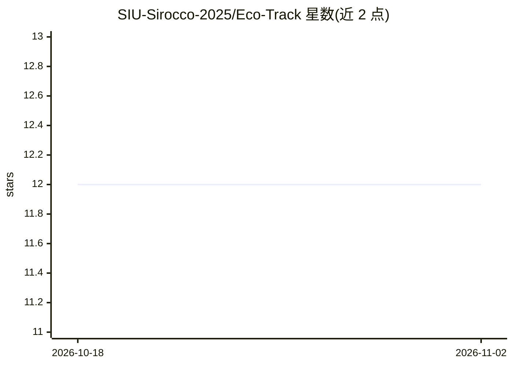

# SIU-Sirocco-2025/Eco-Track

⭐ 12 · JavaScript · GPL-3.0 · 推送 2025-12-29 · [GitHub](https://github.com/SIU-Sirocco-2025/Eco-Track) · [官网](https://ecotrack.asia/) · 组织维护

**胡志明市空气质量监测与 24 小时 AQI 预测系统**

面向胡志明市的空气质量数据平台：通过 node-cron 每小时从 OpenAQ API v3 采集 16 个区县的 AQI 与气象数据，存入 MongoDB；提供仪表盘、AQI 地图、热力图与按时间/区县查询，支持 CSV/JSON 导出。内置预训练 LSTM 模型（输入近 72 小时数据），由 Node 端调用 Python 脚本输出未来 24 小时 AQI 预测，模型参数以 JSON 按区县存放。API 兼容 NGSI-LD/FIWARE 智慧城市标准；运行需 Node.js、MongoDB，预测功能需 Python 3.9+。

## 筛选速览

| 维度 | 判定 | 备注 |
|---|---|---|
| AI 角色 | `ai-native` | 本体是模型或模型工具 |
| 许可风险 | `viral` | GPL-3.0 |
| 部署形态 | `desktop` | 安装包/桌面程序 |
| 模型依赖 | — | README 未给出锁定关系 |
| 硬件要求 | — | 无带数字的原话,不猜 |
| 安装摩擦 | `low` | 无编译、无系统依赖或容器化 |
| 成熟度 | — | 结构信号不足 |

## 能力要点

- 每小时自动采集 OpenAQ v3 数据，覆盖 16 个区县
- LSTM 模型预测未来 24 小时 AQI，按区县存放参数
- 提供 NGSI-LD (ETSI GS CIM 009) 与 FIWARE AirQualityObserved 兼容 API
- 支持 CSV/JSON 数据导出与地图/热力图可视化

## 适用场景

- 查看胡志明市各区实时空气质量与趋势
- 获取未来 24 小时 AQI 预报
- 通过 NGSI-LD API 接入智慧城市系统
- 导出空气质量数据用于研究

## 场景标签

 · 领域:环境监测/智慧城市

## 证据(README 行号)

> L45: - Dự đoán AQI ngắn hạn (24 giờ) bằng mô hình LSTM
> L87: - Sử dụng mô hình LSTM (Long Short-Term Memory) được huấn luyện trước để dự đoán AQI 24 giờ tới
> L106: 4. Python LSTM model xử lý và trả về 24 giá trị AQI dự đoán

## 星数曲线

2026-10-18 12 → 2026-11-02 12（+0）

---
*卡片 v1 · prompt 1.4 · 生成 2026-11-01 · 置信度 high · 依据 README sha `a0d1ac3d2eeb` · [字段定义](../../DATASET.md)*
