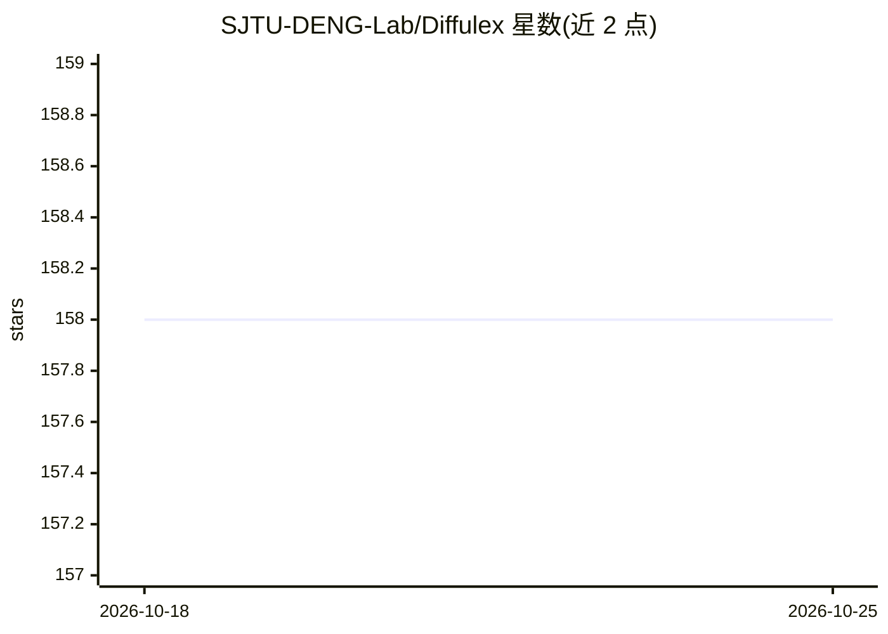

# SJTU-DENG-Lab/Diffulex

⭐ 158 · Python · MIT · 推送 2026-07-13 · [GitHub](https://github.com/SJTU-DENG-Lab/Diffulex) · [官网](https://sjtu-deng-lab.github.io/Diffulex/) · 组织维护 · 中文 README

**扩散语言模型的推理服务引擎，面向研究者**

基于 PagedAttention 式运行时原语构建的扩散语言模型（dLLM）服务引擎：统一运行时涵盖 KV 缓存管理、块调度、前缀复用、MoE 执行、CUDA Graph 回放、HTTP 服务与模型专属扩散采样器。核心是单一后端支持多种解码策略（MultiBD、DMax、LLaDA2.1 Edit Sampling、Fast-dLLM-v2 双缓存等），新策略可作为有界策略改动实现而非重写服务系统。MBD-LMs 实验复现用 mbd-lms 分支（CUDA 12），main 分支面向引擎开发（CUDA 13），依赖 vllm==0.23.0。支持 Dream、LLaDA、SDAR、DiffusionGemma 等模型族。安装与配置细节在外部文档中。

## 筛选速览

| 维度 | 判定 | 备注 |
|---|---|---|
| AI 角色 | `ai-ecosystem` | LLM/agent 周边工具 |
| 许可风险 | `permissive` | MIT |
| 部署形态 | `None` |  |
| 模型依赖 | — | README 未给出锁定关系 |
| 硬件要求 | — | 无带数字的原话,不猜 |
| 安装摩擦 | `medium` | 含编译或系统依赖之一 |
| 成熟度 | — | 结构信号不足 |

## 能力要点

- 单核心后端支持 MultiBD/DMax/Edit Sampling/Fast-dLLM-v2 双缓存等多种解码策略
- Block Buffer 运行时保持静态形状以支持 CUDA Graph 回放
- KV 缓存管理、块调度、前缀复用、MoE 执行、HTTP 服务一体化
- 支持 Dream、LLaDA/LLaDA2、SDAR-MoE、DiffusionGemma 等模型族

## 适用场景

- 为扩散语言模型研究想法提供可运行的后端
- 对 dLLM 做 GSM8K 等基准评测
- 复现 MBD-LMs 论文实验
- 以 HTTP 服务形式部署扩散语言模型并运行本地 demo 可视化

## 场景标签

`推理引擎` `模型评测` · 领域:评测与运维

## 证据(README 行号)

> L8: Diffulex is a Diffusion Language Model Serving Engine built on
> L54: Diffulex `main` is built for researchers who want a real backend for block-level

## 星数曲线

2026-10-18 158 → 2026-10-25 158（+0）

---
*卡片 v1 · prompt 1.4 · 生成 2026-10-22 · 置信度 high · 依据 README sha `52825e8c4eaa` · [字段定义](../../DATASET.md)*
