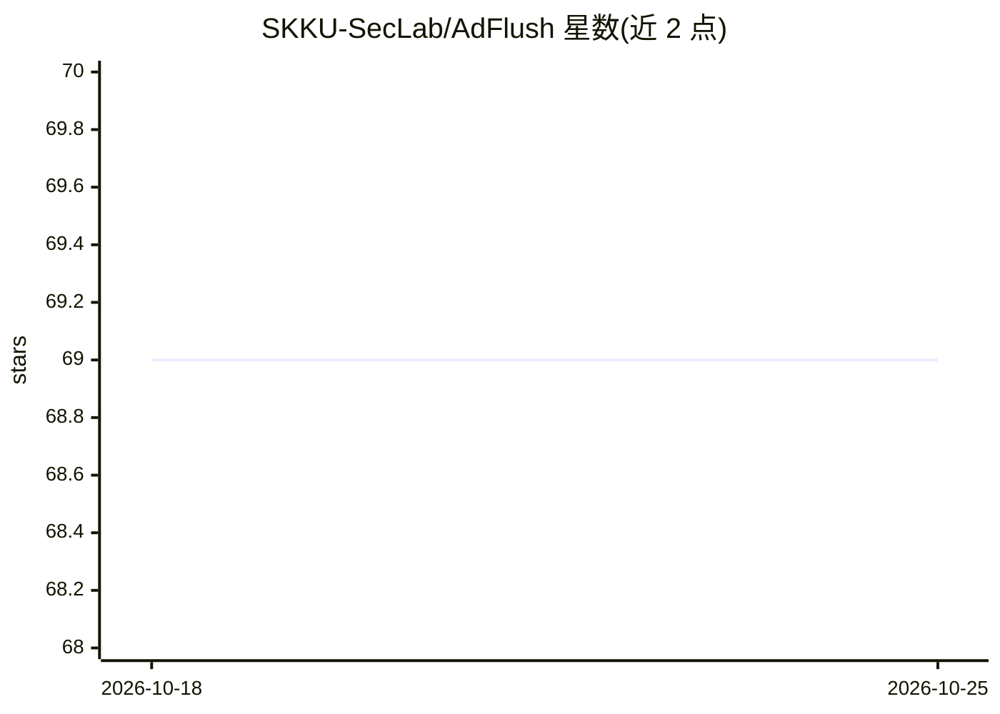

# SKKU-SecLab/AdFlush

⭐ 69 · HTML · 推送 2026-01-19 · [GitHub](https://github.com/SKKU-SecLab/AdFlush) · 组织维护

**基于机器学习的 Chrome 广告与追踪器拦截扩展（WWW 2024 论文）**

成均馆大学 SecLab 发布的科研成果：从 883 个候选特征中筛选 27 个关键特征，训练 ML 分类模型识别并拦截网页广告与追踪器，模型以 ONNX 形式集成到 Chrome 扩展中运行。仓库提供特征工程、模型训练、性能评估、GAN 鲁棒性测试的复现流程（main.py），推荐使用预构建 Docker 镜像，Python 环境需 JDK（H2O 依赖）与 Git LFS。附 10K 真实网页（Tranco 榜单）数据集，含训练/测试/GAN 变异/JS 混淆多套数据。扩展源码不在 Docker 镜像内，需克隆仓库并以 Load unpacked 方式加载。

## 筛选速览

| 维度 | 判定 | 备注 |
|---|---|---|
| AI 角色 | `ai-native` | 本体是模型或模型工具 |
| 许可风险 | `none` | — |
| 部署形态 | `self-host` | docker 或自建部署 |
| 模型依赖 | — | README 未给出锁定关系 |
| 硬件要求 | — | 无带数字的原话,不猜 |
| 安装摩擦 | `low` | 无编译、无系统依赖或容器化 |
| 成熟度 | — | 结构信号不足 |

## 能力要点

- 883 特征中经 RFECV 等流程选出 27 个关键特征
- 模型转换为 ONNX 并集成到 Chrome 扩展中拦截广告/追踪器
- 提供 feature-eng/model-sel/performance-eval/train-gan 完整复现命令
- 开源 Tranco top 10K 网页数据集及 GAN 变异、JS 混淆测试集

## 适用场景

- 在 Chrome 中用 ML 模型检测并拦截广告与网页追踪器
- 复现论文的特征工程、模型训练与性能评估结果
- 研究对抗样本（GAN 变异、JS 混淆）下广告检测模型的鲁棒性

## 场景标签

`科研工具` · 领域:学习与行业

## 证据(README 行号)

> L5: ## AdFlush: A Real-World Deployable Machine Learning Solution for Effective Advertisement and Web Tracker Prevention
> L10: *AdFlush* is the first advertisement and web tracker blocking Chrome Extension based on Machine Learning prediction
> L13: Conventional ad blocking and tracking prevention tools often fall short in addressing web content manipulation. Mac

## 星数曲线

2026-10-18 69 → 2026-10-25 69（+0）

---
*卡片 v1 · prompt 1.4 · 生成 2026-10-24 · 置信度 mid · 依据 README sha `9dce6c3348f0` · [字段定义](../../DATASET.md)*
