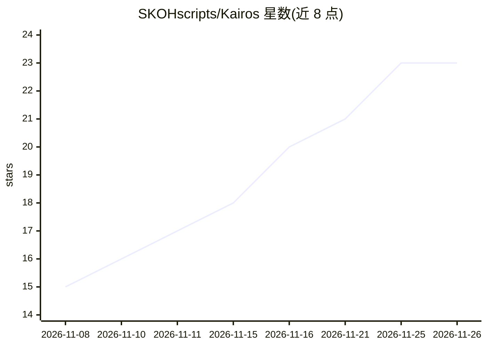

# SKOHscripts/Kairos

⭐ 23 · Kotlin · AGPL-3.0 · 推送 2026-11-25 · [GitHub](https://github.com/SKOHscripts/Kairos) · [官网](https://skohscripts.github.io/Kairos/) · 个人维护

**自排序待办清单：设备端机器学习估计任务耗时**

跨平台（Android/Windows/Linux/macOS/Web）任务管理应用，融合 GTD、敏捷与时间块方法：用 WSJF 公式为任务打优先级分并解释，把任务排入日历空隙，保护深度工作时段，计时并对比预估与实际耗时。4.0 版加入设备端机器学习：基于最近邻（ridge 回归作后备）从已完成任务学习新任务的耗时估计，模型先在最近 30 条任务上回放验证、误差低于默认时长才启用，输出带范围与依据任务列表；另支持通过 Syncthing/Nextcloud 文件夹做无服务器同步。无账号、无广告、无网络权限。

## 筛选速览

| 维度 | 判定 | 备注 |
|---|---|---|
| AI 角色 | `ai-enhanced` | 去掉 AI 部分产品仍成立 |
| 许可风险 | `permissive` | AGPL-3.0 |
| 部署形态 | `desktop` | 安装包/桌面程序 |
| 模型依赖 | — | README 未给出锁定关系 |
| 硬件要求 | — | 无带数字的原话,不猜 |
| 安装摩擦 | `low` | 无编译、无系统依赖或容器化 |
| 成熟度 | — | 结构信号不足 |

## 能力要点

- WSJF 优先级评分（value+criticality/effort），一键解释分数
- 设备端最近邻+ridge 回归估计任务耗时，先在历史任务上验证误差再启用
- 任务排入日历空隙、会议后留缓冲、深度工作时段保护
- 文件级设备同步（Syncthing/Nextcloud），无服务器无网络权限

## 适用场景

- 我不想去排任务，让工具告诉我现在该做什么
- 估计任务耗时老是不准，希望它从我的历史数据学习
- 按 GTD 方法捕捉、整理并执行任务，且数据只留在本机

## 场景标签

 · 领域:效率/任务管理

## 证据(README 行号)

> L46: - **New in 4.0: on-device machine learning learns how long your tasks really
> L102: New in 4.0: a machine-learning model that learns from your finished tasks how
> L107: > **AI? No, machine learning.** No chatbot, no giant model, no cloud: just

## 星数曲线

2026-11-08 15 → 2026-11-26 23（+8）

---
*卡片 v1 · prompt 1.4 · 生成 2026-11-18 · 置信度 high · 依据 README sha `02e36edff010` · [字段定义](../../DATASET.md)*
