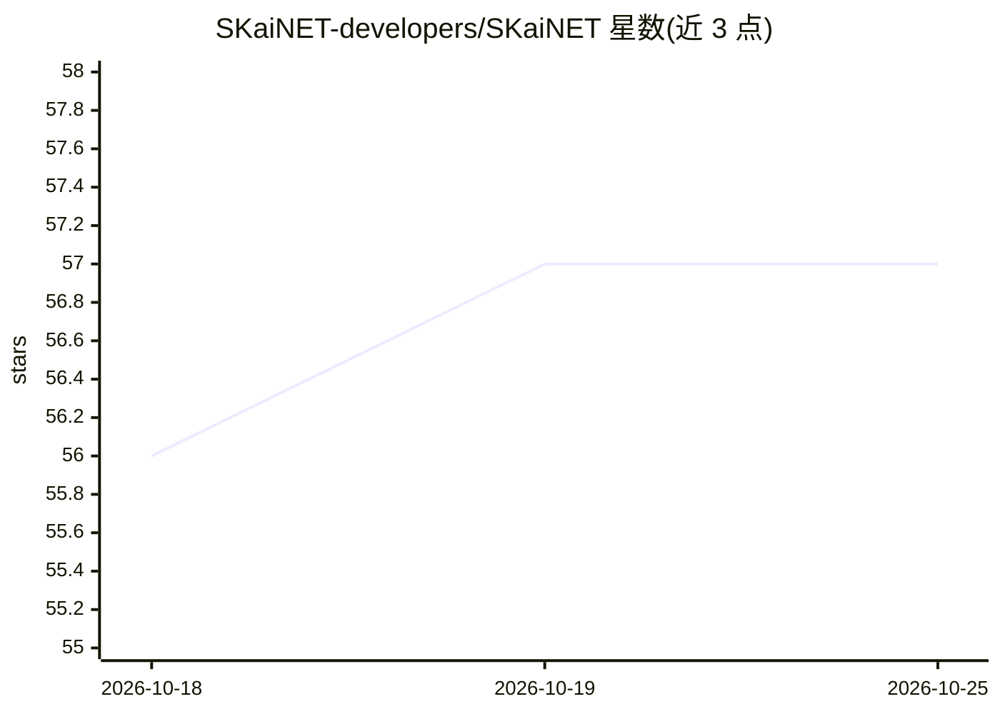

# SKaiNET-developers/SKaiNET

⭐ 57 · Kotlin · MIT · 推送 2026-10-24 · [GitHub](https://github.com/SKaiNET-developers/SKaiNET) · [官网](https://skainet-developers.github.io/SKaiNET/) · 组织维护

**Kotlin 多平台深度学习框架：张量/NN DSL/编译器与本地 GGUF 运行引擎**

面向 Kotlin/Java 开发者的多平台 AI 引擎：提供张量运算、神经网络 DSL（Sequential 与 DAG）、autograd 与 SGD/Adam 优化器，支持 JVM、macOS Native、JS、WASM 目标。模型以 DSL 定义一次后可走 eager 执行或经编译后端生成 StableHLO/MLIR（可接 IREE）、Arduino/C99、Minerva 安全 MCU 代码。内置 GGUF/ONNX/SafeTensors 读写、MNIST/CIFAR 等数据集加载与 Hugging Face URI 数据源，TurboQuant 提供 KV-cache 运行时压缩。LLM 推理（Llama/Qwen/Gemma 等）由姊妹仓库 SKaiNET-transformers 承担，本仓库为其底层引擎。通过 Maven Central 以 Gradle 依赖方式安装。

## 筛选速览

| 维度 | 判定 | 备注 |
|---|---|---|
| AI 角色 | `ai-native` | 本体是模型或模型工具 |
| 许可风险 | `permissive` | MIT |
| 部署形态 | `library` | 以包/库形式分发 |
| 模型依赖 | — | README 未给出锁定关系 |
| 硬件要求 | — | 无带数字的原话,不猜 |
| 安装摩擦 | `low` | 无编译、无系统依赖或容器化 |
| 成熟度 | — | 结构信号不足 |

## 能力要点

- nn{}/dag{} Kotlin DSL 定义模型，一次定义支持 eager 执行与多后端编译
- StableHLO/MLIR、Arduino/C99、Minerva 安全 MCU 三类代码生成后端
- GGUF/ONNX/SafeTensors 格式读写与 HF URI 数据源
- Kotlin Multiplatform 覆盖 JVM/macOS Native/JS/WASM（含浏览器 SIMD128 内核）

## 适用场景

- 在 Kotlin/Java 项目中构建并训练神经网络
- 将训练好的模型编译为 Arduino/C99 或安全 MCU 固件部署到边缘设备
- 在 JVM 或浏览器端本地运行 GGUF 量化模型（经 SKaiNET-transformers）
- 以 Phoronix 兼容基准测试测量计算引擎性能

## 场景标签

`推理引擎` `模型训练` · 领域:训练与推理

## 证据(README 行号)

> L17: SKaiNET is a Kotlin Multiplatform AI framework. New here? Choose the path that
> L146: SKaiNET is built around one path: **a model is defined once in the Kotlin DSL,
> L200: - Targets: JVM, macOS (Native), JS, WASM (Browser + WasmWasi)

## 星数曲线

2026-10-18 56 → 2026-10-25 57（+1）

---
*卡片 v1 · prompt 1.4 · 生成 2026-10-24 · 置信度 mid · 依据 README sha `c45c0983b1cf` · [字段定义](../../DATASET.md)*
