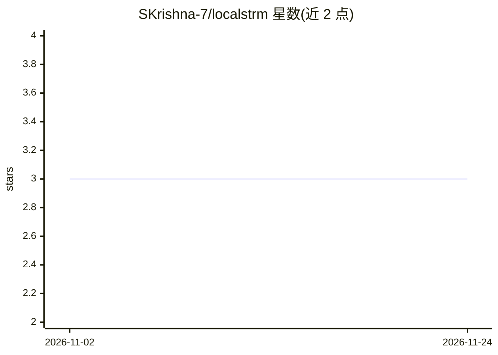

# SKrishna-7/localstrm

⭐ 3 · Python · MIT · 推送 2026-10-31 · [GitHub](https://github.com/SKrishna-7/localstrm) · 个人维护

**供学习 vLLM 原理的 PyTorch 教学型 LLM 推理引擎**

以纯 PyTorch 从头实现 LLM 推理服务的核心机制：分页 KV cache、continuous batching、prefix caching、chunked prefill、preemption 与 INT8 量化推理，每个机制对应独立可读、带测试的组件模块。提供 CLI 与 OpenAI 兼容服务器，支持 Hugging Face 与原生双后端交互聊天。目标读者是想理解 vLLM 设计原理的学生和工程师；README 明确声明它非生产软件、单 GPU、服务器无鉴权，追求速度应使用 vLLM。

## 筛选速览

| 维度 | 判定 | 备注 |
|---|---|---|
| AI 角色 | `ai-ecosystem` | LLM/agent 周边工具 |
| 许可风险 | `permissive` | MIT |
| 部署形态 | `self-host` | docker 或自建部署 |
| 模型依赖 | — | README 未给出锁定关系 |
| 硬件要求 | — | 无带数字的原话,不猜 |
| 安装摩擦 | `low` | 无编译、无系统依赖或容器化 |
| 成熟度 | `idea` | |

## 能力要点

- 分页 KV cache、continuous batching、prefix caching、chunked prefill、preemption 均有对应可读源码模块与测试
- chat CLI 支持 Hugging Face 与原生引擎双后端切换（--engine 参数）
- 含 OpenAI 兼容服务器、Prometheus 指标与下载前显存预检（cli.py check）
- 提供逐概念演示命令（perf-benchmark/prefix-cache/preempt/chunked-prefill）

## 适用场景

- 想搞懂 KV cache 分页与 continuous batching 为什么这样设计
- 在消费级 GPU 上逐条实验调度、前缀缓存、抢占等机制的行为
- 阅读推理引擎源码作为学习路径（代码按概念顺序组织）

## 场景标签

`推理引擎` · 领域:训练与推理

## 证据(README 行号)

> L13: LocalStrm breaks LLM inference into the pieces a serving system is made of (request intake, scheduling, KV-cache me
> L95: **Extras** (not needed to understand vLLM's core ideas): quantization (`src/kernels/quantization.py`), the OpenAI-c
> L97: ## Chat CLI: Choosing an Engine

## 星数曲线

2026-11-02 3 → 2026-11-24 3（+0）

---
*卡片 v1 · prompt 1.4 · 生成 2026-11-22 · 置信度 mid · 依据 README sha `bb1f81fd8d8b` · [字段定义](../../DATASET.md)*
