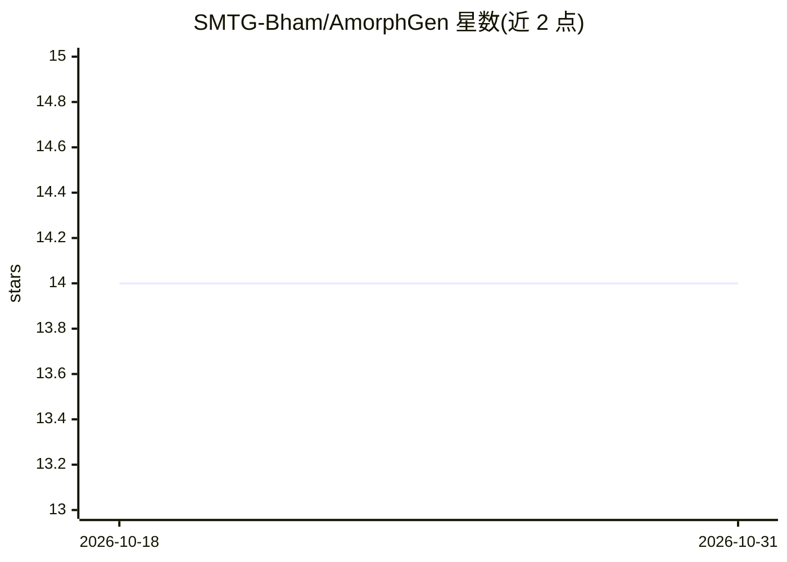

# SMTG-Bham/AmorphGen

⭐ 14 · Python · MIT · 推送 2026-10-30 · [GitHub](https://github.com/SMTG-Bham/AmorphGen) · [官网](https://smtg-bham.github.io/AmorphGen/) · 组织维护

**科研用户的非晶结构生成工具：熔淬 MD 与随机放置**

面向计算材料学科研用户的 Python 包与 CLI，从组分或晶体输入生成非晶结构：随机放置（含配位感知放置）、熔淬分子动力学（含 ensemble 与 hybrid 混合工作流）、两步生成/优化、结构分析（密度、键长、配位数、RDF 等）。机器学习势（MACE/CHGNet/SevenNet）作为可选后端接入，基础包不含 PyTorch，内置 Lennard-Jones/Buckingham 经典势无需 GPU。要求 Python 3.10+，支持 Linux/macOS，Windows 需用 WSL。

## 筛选速览

| 维度 | 判定 | 备注 |
|---|---|---|
| AI 角色 | `ai-enhanced` | 去掉 AI 部分产品仍成立 |
| 许可风险 | `permissive` | MIT |
| 部署形态 | `library` | 以包/库形式分发 |
| 模型依赖 | — | README 未给出锁定关系 |
| 硬件要求 | — | 无带数字的原话,不猜 |
| 安装摩擦 | `medium` | 含编译或系统依赖之一 |
| 成熟度 | — | 结构信号不足 |

## 能力要点

- 三条工作流：随机生成、熔淬 MD、hybrid 混合
- 可选 MLIP 后端（MACE/CHGNet/SevenNet/ACE）+ 内置经典势，基础包无 PyTorch
- MLIP 失败检查：NaN/Inf、近距接触、能量突变、温度/体积失控即停止
- CLI 与 Python API 双入口，YAML 配置与可复现种子

## 适用场景

- 从组分或晶体结构批量生成非晶模型用于模拟研究
- 跑熔淬 MD 并从轨迹快照构建系综结构库
- 对生成的结构做密度、配位数、键角等分析

## 场景标签

`科研工具` · 领域:学习与行业

## 证据(README 行号)

> L75: |**MACE**|`pip install "amorphgen[mace]"`|`mace-mpa-0`, `mace-mpa-0-medium`, `mace-omat-0-medium`, ... (20+ variant
> L131: > **MLIPs are optional.** The base package is deliberately torch-free.

## 星数曲线

2026-10-18 14 → 2026-10-31 14（+0）

---
*卡片 v1 · prompt 1.4 · 生成 2026-10-31 · 置信度 mid · 依据 README sha `7bc0c91f8c9e` · [字段定义](../../DATASET.md)*
