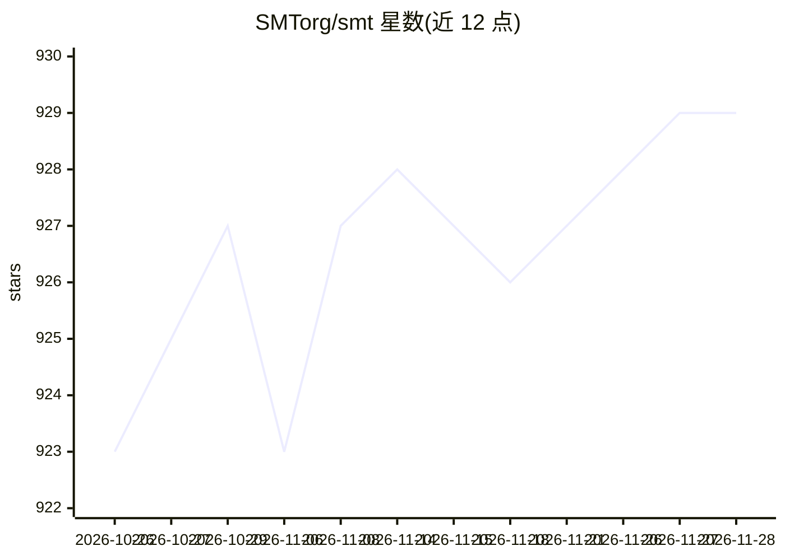

# SMTorg/smt

⭐ 929 · Jupyter Notebook · BSD-3-Clause · 推送 2026-11-16 · [GitHub](https://github.com/SMTorg/smt) · [官网](https://smt.readthedocs.io/en/stable) · 组织维护

**科研用代理建模工具箱：代理模型、采样与基准测试**

SMT 是一个 Python 代理建模工具箱，收录代理建模方法、采样技术与基准测试函数，提供易于使用且便于扩展新方法的代理模型库。特点是以导数为核心：支持梯度增强建模的训练导数、预测导数及对训练数据的导数；并包含其他库没有的模型（偏最小二乘降维 kriging、能量最小化样条插值）。依赖 numpy、scipy、scikit-learn、pydoe，经 pip 安装，New BSD 许可，配套教程与文档及多篇关联科研论文。

## 筛选速览

| 维度 | 判定 | 备注 |
|---|---|---|
| AI 角色 | `ai-native` | 本体是模型或模型工具 |
| 许可风险 | `permissive` | BSD-3-Clause |
| 部署形态 | `library` | 以包/库形式分发 |
| 模型依赖 | — | README 未给出锁定关系 |
| 硬件要求 | — | 无带数字的原话,不猜 |
| 安装摩擦 | `low` | 无编译、无系统依赖或容器化 |
| 成熟度 | — | 结构信号不足 |

## 能力要点

- 代理模型库、采样技术与基准测试函数合集
- 导数支持：训练导数、预测导数、对训练数据的导数
- 独有模型：PLS 降维 kriging 与能量最小化样条插值
- 自定义工具生成自动测试代码与动态图表的用户指南

## 适用场景

- 为高成本仿真或实验数据构建代理模型
- 需要梯度增强或导数输出的预测建模
- 多保真数据融合与代理模型基准测试

## 场景标签

`模型评测` `科研工具` · 领域:评测与运维

## 证据(README 行号)

> L10: The surrogate modeling toolbox (SMT) is a Python package that contains a collection of surrogate modeling methods, 
> L12: SMT is different from existing surrogate modeling libraries because of its emphasis on derivatives, including train
> L39: SMT depends on the following modules: numpy, scipy, scikit-learn and pydoe.

## 星数曲线

2026-10-26 923 → 2026-11-28 929（+6）

---
*卡片 v1 · prompt 1.4 · 生成 2026-11-24 · 置信度 high · 依据 README sha `c6c8f5f88ad5` · [字段定义](../../DATASET.md)*
